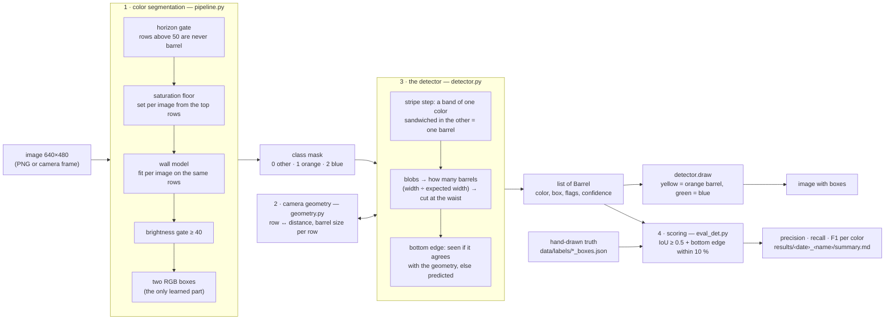
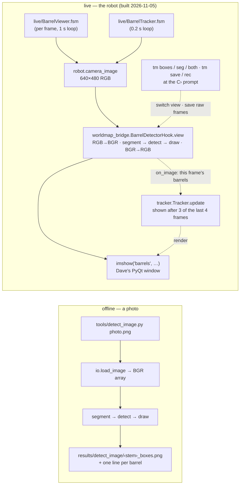
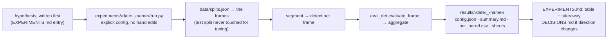

# ARCHITECTURE.md — how the pieces fit

The code in one picture, then each layer. For *why* each step works, read `HOW-IT-WORKS-SHORT.md` (one page) and `HOW-IT-WORKS.md` (the long form). State as of 2026-11-05.

## 1. What happens to one image



The same thing in plain text:

```
 image ──► [1] segmentation ──► class mask ──► [3] detector ──► barrels ──► draw ──► image with boxes
 640×480    pipeline.py          0 / 1 / 2       detector.py       │                     (yellow / green)
            per-image gates +                        ▲             │
            two learned RGB boxes                    │             └──► [4] eval_det.py ◄── *_boxes.json (truth)
                                               [2] geometry.py           precision / recall / F1
                                               row ↔ distance,
                                               barrel size per row
```

Numbers worth remembering: horizon row ≈ 76; a barrel at 20 cm is ≈ 51 px wide and 55 px tall; the front end is the hs model `eb863d84` (orange hue 3–13 S ≥ 140, blue hue 103–119 S ≥ 113); the detector scores **0.99** on the 21 campus train frames (v1 front end: 0.41) and **0.93** at home (mean F1, v2 rule).

## 2. The two front doors

The chain above is one function call deep (`segment` then `detect`). Two programs call it:



Everything robot-specific sits in `worldmap_bridge.py` (the hook), `live/barrel_live.py` (what the two programs share: the hook, the view modes, `tm save` / `tm rec`) and the two `.fsm` files (a dozen lines of state machine each). `tracker.py` (the 3-of-4 persistence `BarrelTracker` shows) and `capture.py` (saving raw frames) are plain Python with tests. The detector never knows which door it came through, and the per-frame answer is the same in both programs.

**Channel order.** OpenCV reads, writes and draws in BGR, so inside `barrels` an image array is BGR. `pipeline.Frame.from_image` splits it into named R, G, B planes at once, so the actual color math and every number in the docs are RGB. The robot and Dave's `imshow` speak RGB; the hook converts on the way in and on the way out, two lines in total.

## 3. The modules, by layer

All under `src/barrels/`. **Main code** (walked through before every commit, explained in `HOW-IT-WORKS.md`) is marked ★; the rest can be treated as black boxes.

| layer | file | what it is | the names to know |
|---|---|---|---|
| front end ★ | `pipeline.py` | the v1 color segmentation: gates + two RGB boxes; `fit` learns the boxes once, `segment` runs them | `Config`, `Frame.from_image`, `Model`, `effective_s_min`, `fit`, `segment` |
| front end | `priors.py` | the robust (median / MAD) color model used for the wall and table | `band_stats`, `reject_like` |
| front end | `boxfit.py` | percentile RGB boxes and their diagnostics | `Box`, `fit_box`, `in_box`, `fullness`, `pca` |
| front end | `cleanup.py` | speck removal / opening / hole filling; **off** (tie, 2026-10-28) | `apply` |
| geometry ★ | `geometry.py` | pinhole camera: row ↔ distance, the barrel's rows and width at any distance, presets | `CameraModel`, `barrel_rows`, `horizon_row`, `AIM_4A8B6118_BOXFIT` |
| detector ★ | `detector.py` | steps 1–4: blobs, count by width, bottom edge, the stripe; `draw` | `DetConfig`, `find_blobs`, `split_blob`, `resolve_bottom`, `find_stripes`, `barrel_from_stripe`, `detect`, `draw` |
| detector | `detect_types.py` | one detected barrel and its conversions (incl. the aivision dict the world map reads) | `Barrel`, `barrels_from_boxes` |
| detector | `detect_cc.py` | the floor: one box per connected blob, never tuned | `detect`, `write_detections` |
| scoring ★ | `eval_det.py` | box matching and metrics under the v1 and v2 rules; result tables | `evaluate_frame`, `match_best_first`, `aggregate`, `write_results`, `score` |
| scoring | `eval.py` | the v1 per-pixel metrics (IoU per class, negative-frame FP rate) | `evaluate_image`, `aggregate` |
| scoring | `splits.py`, `cv.py` | fixed splits (`data/splits.json`), leave-one-scene-out folds, sweeps, `fresh_dir`, `git_hash` | `loso_folds`, `cross_validate`, `run_configs`, `assign_holdout_per_scene` |
| data | `io.py` | load / save images, masks, strokes, instances, **box labels**; filename parsing; validators | `load_image`, `load_mask`, `load_boxes`, `save_boxes`, `parse_name`, `PKG_ROOT` |
| data | `labeling.py`, `instances.py` | scribble-and-grow masks; the automatic per-barrel split (superseded by boxes 2026-11-02, files kept) | `grow`, `split_instances` |
| data | `viz.py` | overlays and the spec's flat-color output images | `overlay`, `render_outputs`, `debug_sheet` |
| robot | `worldmap_bridge.py` | the hook the live feed runs: the hs model (or `$BARRELS_MODEL`) + detector + camera, RGB in / RGB out (`view` = `on_image` + `render`); the aivision-dict route for later | `BarrelDetectorHook`, `barrels_to_aivision_items`, `with_items` |
| robot | `tracker.py` | the multi-frame view: a barrel is shown after 3 of the last 4 frames, kept through a miss, forgotten after 4 in a row; box = per-edge median of recent boxes | `Tracker`, `TrackConfig` |
| robot | `capture.py` | `tm save` / `tm rec`: raw frames to `snapshots/` in the camera viewer's naming; timed recordings with `frames.json` | `FrameCapture` |

Outside `src/`:

| folder | contents |
|---|---|
| `tools/` | one CLI per job: `detect_image.py` (the detector on a photo), `segment_image.py` (the segmentation alone), `eval_boxes.py` / `eval_masks.py` (score a folder of predictions), `box_tool.py` (draw truth boxes), `label_tool.py` / `instance_tool.py` (v1 masks, v1.5 instances), `import_snaps.py` / `import_dave_zip.py` (bring frames in), `make_splits.py`, `attach_measured.py` |
| `live/` | `BarrelViewer.fsm` (per frame) and `BarrelTracker.fsm` (persisting boxes) with the `.py` files `genfsm` writes from them; `barrel_live.py`, the base both share (hook, view modes, `tm save` / `tm rec`) |
| `experiments/‹date›_‹name›/run.py` | one script per experiment; every number in the docs comes from one of these |
| `results/‹date›_‹name›/` | what the experiments write: `config.json` (with the git hash), `summary.md/csv`, `per_image.csv`, `per_barrel.csv`; sheets are gitignored |
| `data/raw/`, `data/labels/`, `data/splits.json` | the frames, their labels (`_boxes.json` is the truth; `_mask.png`, `_inst.*` are the v1/v1.5 labels), the split assignment |
| `tests/` | unit tests for the infrastructure (IO, metrics, geometry, the detector's mechanics on synthetic masks); algorithms are judged by experiments, not tests |

## 4. The experiment loop



Rules that keep the numbers honest (`EVAL.md`, `CLAUDE.md`): the 5 test frames are evaluated once per milestone with one pre-chosen config; tuning uses cross-validation that holds out whole scenes; the selection rule (ties under 0.02, disqualify on a clean negative) is written down before a sweep; `cv.fresh_dir` refuses to overwrite a results folder.

## 5. Conventions

- **Mask values:** 0 other, 1 orange, 2 blue, 255 ignore (hand labels only). The orange stripe of a blue barrel is orange.
- **Boxes:** `[x0, y0, x1, y1]`, half-open, in the 640×480 frame, clipped to it. A `Barrel.color` is the *body* color.
- **Flags on a detected barrel:** `bottom_inferred`, `top_inferred` (edge drawn from the geometry), `occluded` (stripe partly hidden, full box drawn), `truncated` (touches the frame edge). `source` is `det2` for a stripe barrel, `det1` for a stripeless piece.
- **Nothing is learned per image.** The hue sector and saturation floor per class were fit once (`results/2026-11-09_hs_candidate/config.json`, config `eb863d84`, adopted 2026-11-09); nothing is estimated from the image being segmented; everything else is geometry. (v1, `afd85483`, estimated a saturation floor and a wall model per image from the top rows; that is what failed in real rooms.)
- **Cameras:** `AIM_4A8B6118_BOXFIT` (f 400, tilt 22.25°, horizon 76) is the default until the calibration session; `AIM_4A8B6118` is the October measurement; `NOMINAL` is Dave's 23° / 400.
- **Config hashes:** a `pipeline.Config` hashes to an 8-character id; `afd85483` is pinned by a test so new fields cannot silently change it.
- **Dates in names:** `experiments/` and `results/` folders start with the run date; a result folder is never overwritten (re-runs get a new name or the old one is moved aside).

## 6. Repo layout

```
vex-aim-tools/                 Dave's upstream (aim_fsm, viewer, genfsm, simple_cli) — not touched for barrel work
└── barrels/                   everything of ours
    ├── CLAUDE.md              the working rules
    ├── README.md              start here: what, the commands, where to read
    ├── pyproject.toml         `pip install -e barrels` from the repo root
    ├── src/barrels/           the package (table above)
    ├── tools/                 CLIs
    ├── live/                  the robot programs (BarrelViewer.fsm, BarrelTracker.fsm → .py; barrel_live.py shared)
    ├── experiments/           one folder per experiment
    ├── results/               what they wrote (summaries committed, images not)
    ├── data/                  frames, labels, splits
    ├── tests/                 pytest
    └── docs/                  PROBLEM (spec) · constraints · EVAL · STATUS · TODO · EXPERIMENTS · DECISIONS ·
                               DATA · RUNBOOK · HOW-IT-WORKS(-SHORT) · ARCHITECTURE · MEETING-* · archive/
```
