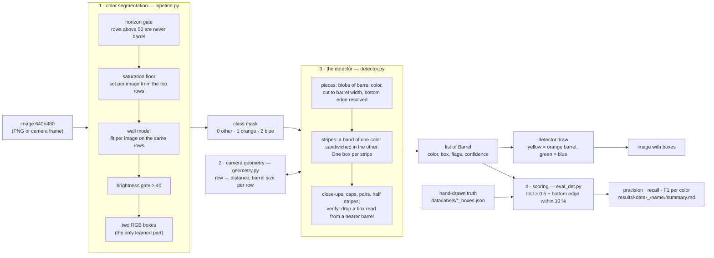
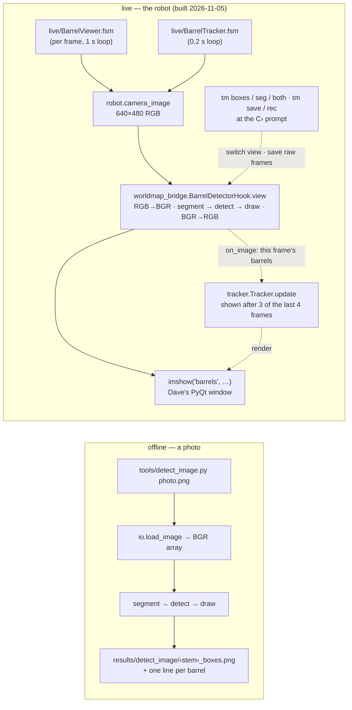
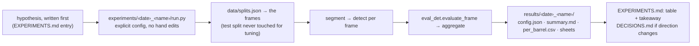

# ARCHITECTURE.md — how the pieces fit

The code in one picture, then each layer. For *why* each step works, read `HOW-IT-WORKS-SHORT.md` (one page) and `HOW-IT-WORKS.md` (the long form); for the detector check by check, `DETECTOR-MAP.md`. State as of 2026-11-05.

## 1. What happens to one image



The same thing in plain text:

```
 image ──► [1] segmentation ──► class mask ──► [3] detector ──► barrels ──► draw ──► image with boxes
 640×480    pipeline.py          0 / 1 / 2       detector.py       │                     (yellow / green)
            per-image gates +                        ▲             │
            two learned RGB boxes                    │             └──► [4] eval_det.py ◄── *_boxes.json (truth)
                                               [2] geometry.py           precision / recall / F1
                                               row ↔ distance,
                                               barrel size per row
```

Numbers worth remembering: horizon row ≈ 76; a barrel at 20 cm is ≈ 51 px wide and 55 px tall; the front end is the hs model `eb863d84` (orange hue 3–13 S ≥ 140, blue hue 103–119 S ≥ 113); the detector scores **0.99** on the 21 campus train frames (v1 front end: 0.41) and **0.93** at home (mean F1, v2 rule).

## 2. The two front doors

The chain above is one function call deep (`segment` then `detect`). Two programs call it:



Everything robot-specific sits in `worldmap_bridge.py` (the hook), `live/barrel_live.py` (what the two programs share: the hook, the view modes, `tm save` / `tm rec`) and the two `.fsm` files (a dozen lines of state machine each). `tracker.py` (the 3-of-4 persistence `BarrelTracker` shows) and `capture.py` (saving raw frames) are plain Python with tests. The detector never knows which door it came through, and the per-frame answer is the same in both programs.

**Channel order.** OpenCV reads, writes and draws in BGR, so inside `barrels` an image array is BGR. `pipeline.Frame.from_image` splits it into named R, G, B planes at once, so the actual color math and every number in the docs are RGB. The robot and Dave's `imshow` speak RGB; the hook converts on the way in and on the way out, two lines in total.

## 3. The modules, by layer

All under `src/barrels/`. **Main code** (walked through before every commit, explained in `HOW-IT-WORKS.md`) is marked ★; the rest can be treated as black boxes.

| layer | file | what it is | the names to know |
|---|---|---|---|
| front end ★ | `pipeline.py` | the v1 color segmentation: gates + two RGB boxes; `fit` learns the boxes once, `segment` runs them | `Config`, `Frame.from_image`, `Model`, `effective_s_min`, `fit`, `segment` |
| front end | `priors.py` | the robust (median / MAD) color model used for the wall and table | `band_stats`, `reject_like` |
| front end | `boxfit.py` | percentile RGB boxes and their diagnostics | `Box`, `fit_box`, `in_box`, `fullness`, `pca` |
| front end | `adaptive.py` | the adaptive color rule (2026-11-23, **off** by default, `Config.hs_adapt`): per frame, a threshold moved along a line through the home point on one number of the frame's own histogram; the slope fit with every place weighted equally (`experiments/2026-11-24_adaptive`) | `Term`, `adapted_boxes`, `frame_thresholds`, `fit_slope`, `place_weights` |
| front end | `lightcolor.py` | the blue box follows the light (2026-11-25, **off** by default, `Config.hs_light`): the light's warmth from the frame's brightest pixels lowers the blue S floor and hue low end; failed its PREREG (`experiments/2026-11-25_color`) | `light_warmth`, `share`, `warm_blue_boxes`, `validate` |
| analysis | `conditions.py` | place (table + room) and light kind (window / overhead / lamp / mixed) of each condition, from `data/conditions.json`; a missing one is guessed from its tags and flagged | `info`, `load_table` |
| front end | `cleanup.py` | speck removal / opening / hole filling; **off** (tie, 2026-10-28) | `apply` |
| geometry ★ | `geometry.py` | pinhole camera: row ↔ distance, the barrel's rows and width at any distance, presets | `CameraModel`, `barrel_rows`, `horizon_row`, `AIM_4A8B6118_BOXFIT` |
| detector ★ | `detector.py` | ten stages in a fixed order, 18 numbers, no switches (collapsed 2026-11-26; guide: `DETECTOR-MAP.md`): pieces (blobs, count by width, bottom edge), stripes, one box per stripe (a partly seen stripe placed by what is seen, a side hidden only for a reason, else by the barrel's outline), close-ups, verify (a barrel cannot be seen through a nearer one; a guessed side needs a seen edge), caps (a top behind a found barrel), pairs (two slices behind a post), half stripes (body on one side only); `draw` | `DetConfig`, `detect`, `find_pieces`, `find_stripes`, `boxes_from_stripes`, `closeup_pieces`, `drop_seen_through`, `caps_behind`, `post_pairs`, `half_stripes`, `drop_single_reading`, `BarrelAt`, `Found`, `draw` |
| detector | `detect_types.py` | one detected barrel and its conversions (incl. the aivision dict the world map reads) | `Barrel`, `barrels_from_boxes` |
| detector | `detect_cc.py` | the floor: one box per connected blob, never tuned | `detect`, `write_detections` |
| scoring ★ | `eval_det.py` | box matching and metrics under the v1 and v2 rules; result tables | `evaluate_frame`, `match_best_first`, `aggregate`, `write_results`, `score` |
| scoring ★ | `report.py` | the one table (2026-11-11): data set × scenario rows, a candidate arm and a baseline arm (color-model file + `DetConfig` overrides) side by side with the difference; refuses test frames; numbers from `eval_det` unchanged. Since 2026-11-18 an arm can also be the robot's built-in (vendor) detector, its boxes read from `data/vendor/` and scored the same way on the frames that have a vendor file, and two looser counts (overlap alone, position) are reported. Since 2026-11-26 also the by-place view (`--places`): the same run counted per placement by `counting.py`, by place and by condition, with the vendor ASSUMED on the white tables that have no vendor file | `select_frames`, `refuse_test_frames`, `Arm`, `run_arm`, `summarize`, `build_rows`, `make_report`, `format_text`, `write_all`, `vendor_arm`, `vendor_coverage`, `score_boxes`, `loose_counts`, `place_tables`, `format_places`, `assumed_vendor_stems` |
| scoring ★ | `counting.py` | the counting (2026-11-26): every true barrel found / found with the box off / missed and every box on its barrel / wrong color / second box / on nothing (a box is on a barrel when half of the smaller of the two boxes lies inside the other; the strict hits are the v2 rule's, unchanged); which label box is which physical barrel across the lights of an arrangement; tallies in which every placement counts once | `classify_frame`, `is_on`, `FrameCount`, `build_placements`, `Placements`, `tally`, `Tally`, `group_stems`, `assumed_perfect`, `format_table` |
| scoring ★ | `gate.py` | the never-regress check, with a margin since 2026-11-26: a run stored one line per frame (`results/baseline/baseline.json`) and compared with this run; a protected set (`results/baseline/protected.json`: HOME, CAMPUS, the glass table, pale wood, the ABP white occlusion set, the cool-lamp bathroom) fails when its found per placement is lower, or its boxes not on their barrel higher, by more than its margin (`results/baseline/margins.json`, measured); a new box on a clean empty frame fails in any set; every changed barrel is listed | `snapshot`, `save_baseline`, `load_protected`, `Group`, `load_margins`, `Margins`, `compare`, `SetChange`, `GateResult`, `format_gate` |
| scoring ★ | `judge.py` | the standard pass rule (2026-11-26): a baseline and a candidate, each any `detect_frame(stem, frame) -> list[Barrel]` (or a model file + `DetConfig` fields), run on the ordinary train conditions; refuses test frames; per place and overall, strict and second accounting, every barrel gained and lost; the verdict PASS / FAIL / NO CLEAR DIFFERENCE from four clauses with measured margins; a candidate with fitted numbers is judged leave one place out | `judge`, `train_frames`, `load_frame`, `model_detector`, `fixed_detector`, `leave_one_place_out`, `run_many`, `Run`, `compare`, `decide`, `Margins`, `load_margins`, `Judgement`, `format_judgement`, `write` |
| scoring | `eval.py` | the v1 per-pixel metrics (IoU per class, negative-frame FP rate) | `evaluate_image`, `aggregate` |
| analysis | `hshist.py` | hue × saturation histograms per set of frames (TODO 8): body / rest pixels from the boxes, where the colors sit, the ceiling of an H × S lookup, the pictures; feeds nothing in the detector | `SetHist`, `region_masks`, `recall_at_flood`, `figure_set`, `figure_bars` |
| analysis | `hslabel.py` | hand-set color thresholds as label data (2026-11-18): the six numbers (hue low, hue high, S floor per color; orange hue on a line from −30 so −3 = 177) ↔ a `pipeline.Model` with the adopted model's two boxes replaced; which frames may be slider-labeled (train only, test frames refused); the label dict. Builds models, thresholds nothing itself | `model_from_thresholds`, `thresholds_from_model`, `adopted_model`, `select_frames`, `require_labelable`, `label_meta` |
| analysis | `hsrel.py` | histogram against thresholds (TODO F, 2026-11-18): conditions (one table under one light; ordinary / extreme / excluded), nine label-free features of a frame's H × S histogram, the six thresholds to and from a model, Spearman + permutation p + Holm, leave-one-condition-out prediction with the feature chosen inside the loop; used by `experiments/2026-11-18_hs_relation/run.py`; feeds nothing in the detector | `group_conditions`, `frame_features`, `model_from_thresholds`, `perm_pvalue`, `holm`, `loco` |
| analysis | `degrade.py` | seeded, measured damage to a good class mask (highlights, eaten edges, dropout, a stripe in pieces, specks), for the test "good segmentation in, every barrel out" (`experiments/2026-11-18_det_given_seg`); feeds nothing in the detector; `REALISTIC` / `WORST_SEEN` are levels measured on real white-table segmentation (2026-11-19), under their own names | `Damage`, `SEVERITIES`, `SINGLE`, `REALISTIC`, `WORST_SEEN`, `LEVELS`, `damage` |
| analysis | `damage_measure.py` | the other direction: the damage of a mask read back in the units of `degrade.py` (share not painted, edges eaten in px, dropout, holes on the upper body and across the stripe, the stripe in pieces, specks), with a hand mask or with boxes only (`experiments/2026-11-19_damage_realism`); feeds nothing in the detector | `measure_barrel`, `measure_box`, `specks`, `speck_counts`, `column_runs` |
| analysis | `occlude.py` | a measured part of one barrel hidden in a class mask (2026-11-19): an edge, a slanted edge, both sides, from above, from below, a post, the frame edge (pixels erased); a barrel of the other or the same color in front, scaled for its row, or a plain block of barrel color (pixels pasted); for the occlusion scorecard (`experiments/2026-11-19_det_occl`); feeds nothing in the detector | `Source`, `Scene`, `cut_source`, `make_scene`, `KINDS`, `AMOUNTS` |
| analysis | `stencil.py` | a second opinion on the class mask (2026-11-20, `experiments/2026-11-20_stencil`): a barrel-shaped stencil per size slid along its rows, one score per place; tried as a detector, as an adder and as a checker of the rule detector's boxes (`experiments/2026-11-20_occl_combined`); not adopted, called by nothing in the detector or the live view | `StencilConfig`, `stencils`, `score_at`, `detect`, `box_score`, `same_barrel` |
| scoring | `splits.py`, `cv.py` | fixed splits (`data/splits.json`), leave-one-scene-out folds, sweeps, `fresh_dir`, `git_hash` | `loso_folds`, `cross_validate`, `run_configs`, `assign_holdout_per_scene`, `assign_holdout_by_scene` (a set shot under several lights: all lights of one arrangement share a split), `look_refusal` (which frames Claude may look at to propose boxes: train, or kept out of every split on purpose) |
| data | `io.py` | load / save images, masks, strokes, instances, **box labels**, Claude's box proposals (`_boxes_proposed.json`, never truth), slider labels (`_hs.json`, written atomically); the saved vendor detections (`data/vendor/`); filename parsing; validators | `load_image`, `load_mask`, `load_boxes`, `save_boxes`, `proposal_path`, `load_proposal`, `save_proposal`, `hs_path`, `load_hs`, `save_hs`, `parse_name`, `PKG_ROOT`, `vendor_path`, `load_vendor`, `vendor_barrels` |
| data | `labeling.py`, `instances.py` | scribble-and-grow masks; the automatic per-barrel split (superseded by boxes 2026-11-02, files kept) | `grow`, `split_instances` |
| data | `viz.py` | overlays and the spec's flat-color output images | `overlay`, `render_outputs`, `debug_sheet` |
| robot | `worldmap_bridge.py` | the hook the live feed runs: the hs model (or `$BARRELS_MODEL`) + detector + camera, RGB in / RGB out (`view` = `on_image` + `render`); the aivision-dict route for later | `BarrelDetectorHook`, `barrels_to_aivision_items`, `with_items` |
| robot | `tracker.py` | the multi-frame view: a barrel is shown after 3 of the last 4 frames, kept through a miss, forgotten after 4 in a row; box = per-edge median of recent boxes | `Tracker`, `TrackConfig` |
| robot | `capture.py` | `tm save` / `tm rec`: raw frames to `snapshots/` in the camera viewer's naming; timed recordings with `frames.json`; since 2026-11-18 the vendor detector's answer for the same frame (`robot_snapN_vendor.json` + a look-at `.png`), read from the robot's status without ever failing a save | `FrameCapture`, `grab_vendor`, `vendor_record`, `vendor_bbox` |

Outside `src/`:

| folder | contents |
|---|---|
| `tools/` | one CLI per job: `detect_image.py` (the detector on a photo), `segment_image.py` (the segmentation alone), `eval_boxes.py` / `eval_masks.py` (score a folder of predictions), `report.py` (the one table: candidate vs baseline per data set × scenario; `--vendor` = against the robot's built-in detector; `--places` = the same run per placement and by place; `--gate` / `--save-baseline` = the never-regress check, with a margin), `judge.py` (the standard pass rule: a candidate against a baseline on the ordinary train conditions, PASS / FAIL / NO CLEAR DIFFERENCE; the candidate is a model file, `DetConfig` fields, a function, or a `fit` function judged leave one place out), `box_tool.py` (draw truth boxes; opens Claude's proposal dashed when a frame has no label yet: `a` accepts, `r` rejects), `box_look.py` (no window: the frame or a zoomed crop with a labelled pixel grid, expected barrel sizes and a draft proposal drawn on top, for a Claude session proposing boxes; `--save` writes `_boxes_proposed.json`; refuses test frames), `copy_boxes.py` (copy hand-drawn boxes to the other lights of a fixed scene, unreviewed), `label_tool.py` / `instance_tool.py` (v1 masks, v1.5 instances), `import_snaps.py` / `import_dave_zip.py` (bring frames in; `import_snaps.py` carries each frame's `_vendor.json` to `data/vendor/`), `make_splits.py`, `attach_measured.py`, `hs_hist.py` (hue × saturation histogram pictures of a set), `hs_slider.py` (six sliders for the color thresholds on one frame, live segmentation and boxes; saves `_hs.json`; train frames only) |
| `live/` | `BarrelViewer.fsm` (per frame) and `BarrelTracker.fsm` (persisting boxes) with the `.py` files `genfsm` writes from them; `barrel_live.py`, the base both share (hook, view modes, `tm save` / `tm rec`) |
| `experiments/‹date›_‹name›/run.py` | one script per experiment; every number in the docs comes from one of these |
| `experiments/run_all.py` | the nightly run (2026-11-23): tests, the never-regress check, the eval table, ours vs the vendor (`experiments/2026-11-24_vendor/run.py`), the adaptive rule if its script exists; each step's exit code kept, failures do not stop the run; writes one page `results/<today>_run_all/summary.md` with the data still missing at the top (file names only; test frames counted, never opened) |
| `results/‹date›_‹name›/` | what the experiments write: `config.json` (with the git hash), `summary.md/csv`, `per_image.csv`, `per_barrel.csv`; sheets are gitignored |
| `results/baseline/` | `baseline.json`: the run the never-regress check compares with (one line per frame: the state of every barrel and box, with the date and git hash; written by `tools/report.py --save-baseline`); `protected.json`: the sets the check protects; `margins.json`: the measured noise, the margins of the check and of the pass rule (written by `experiments/2026-11-26_noise_floor/run.py`; re-run it when the default model or detector changes) |
| `data/raw/`, `data/labels/`, `data/splits.json` | the frames, their labels (`_boxes.json` is the truth; `_boxes_proposed.json` Claude's proposal for a frame not yet boxed, a starting point that nothing scoring reads; `_hs.json` the hand-set color thresholds; `_mask.png`, `_inst.*` are the v1/v1.5 labels), the split assignment |
| `data/vendor/` | `<stem>_vendor.json`: what the robot's built-in detector reported for the frame when it was saved (schema: `DATA.md`); a measurement, never a label |
| `tests/` | unit tests for the infrastructure (IO, metrics, geometry, the detector's mechanics on synthetic masks); algorithms are judged by experiments, not tests. `conftest.py` prints the eval report table at the end of a full run (train frames, ≈ 15 s; `BARRELS_NO_REPORT=1` skips it) |

## 4. The experiment loop



Rules that keep the numbers honest (`EVAL.md`, `CLAUDE.md`): the 5 test frames are evaluated once per milestone with one pre-chosen config; tuning uses cross-validation that holds out whole scenes; the selection rule (ties under 0.02, disqualify on a clean negative) is written down before a sweep; `cv.fresh_dir` refuses to overwrite a results folder.

## 5. Conventions

- **Mask values:** 0 other, 1 orange, 2 blue, 255 ignore (hand labels only). The orange stripe of a blue barrel is orange.
- **Boxes:** `[x0, y0, x1, y1]`, half-open, in the 640×480 frame, clipped to it. A `Barrel.color` is the *body* color.
- **Flags on a detected barrel:** `bottom_inferred`, `top_inferred` (edge drawn from the geometry), `occluded` (stripe partly hidden, full box drawn), `truncated` (touches the frame edge). `source` is `det2` for a barrel found from its stripe (also from a stripe with body on one side only, a pair of slices or a slice beside a found barrel, 2026-11-20), `det1` for a stripeless piece, `det3` for a top behind a found barrel.
- **Nothing is learned per image.** The hue sector and saturation floor per class were fit once (`results/2026-11-09_hs_candidate/config.json`, config `eb863d84`, adopted 2026-11-09); nothing is estimated from the image being segmented; everything else is geometry. (v1, `afd85483`, estimated a saturation floor and a wall model per image from the top rows; that is what failed in real rooms.)
- **Cameras:** `AIM_4A8B6118_BOXFIT` (f 400, tilt 22.25°, horizon 76) is the default until the calibration session; `AIM_4A8B6118` is the October measurement; `NOMINAL` is Dave's 23° / 400.
- **Config hashes:** a `pipeline.Config` hashes to an 8-character id; `afd85483` is pinned by a test so new fields cannot silently change it.
- **Dates in names:** `experiments/` and `results/` folders start with the run date; a result folder is never overwritten (re-runs get a new name or the old one is moved aside).

## 6. Repo layout

```
vex-aim-tools/                 Dave's upstream (aim_fsm, viewer, genfsm, simple_cli) — not touched for barrel work
└── barrels/                   everything of ours
    ├── CLAUDE.md              the working rules
    ├── README.md              start here: what, the commands, where to read
    ├── pyproject.toml         `pip install -e barrels` from the repo root
    ├── src/barrels/           the package (table above)
    ├── tools/                 CLIs
    ├── live/                  the robot programs (BarrelViewer.fsm, BarrelTracker.fsm → .py; barrel_live.py shared)
    ├── experiments/           one folder per experiment
    ├── results/               what they wrote (summaries committed, images not)
    ├── data/                  frames, labels, splits
    ├── tests/                 pytest
    └── docs/                  PROBLEM (spec) · constraints · EVAL · STATUS · TODO · EXPERIMENTS · DECISIONS ·
                               DATA · RUNBOOK · HOW-IT-WORKS(-SHORT) · ARCHITECTURE · MEETING-* · archive/
```
