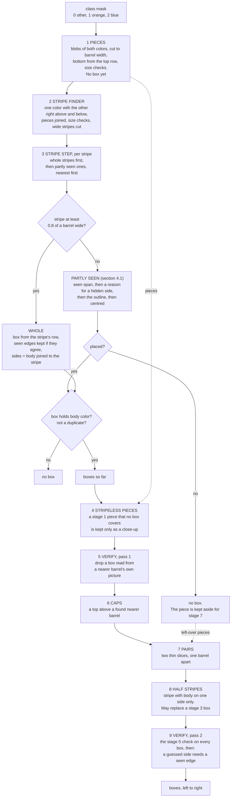
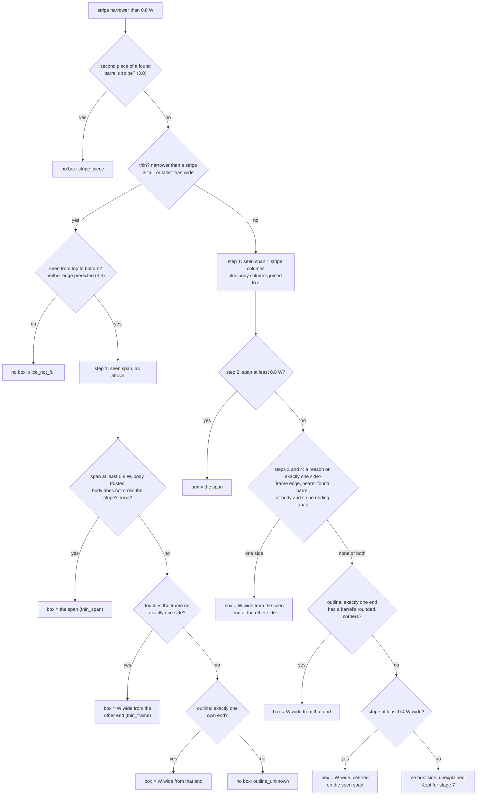

# DETECTOR-MAP.md — what `detect()` does, check by check

**Now (2026-11-26).** This is the map of `barrels/src/barrels/detector.py` as it stands on `barrels` at commit `d77ddb2` (1904 lines). It answers TODO items U1 (the map), U2 (the marks, section 5) and prepares K1 (the collapse, section 8). No code was changed to write it.

- Every line number (`l.123`) is a line of that file. Every statement about the code was read off the code.
- "audit" = the detector audit of 2026-11-23 (`detector_audit.md` in the reviewer session's scratchpad; not in the repo). It read the same file, byte for byte (checked with `diff`). Its real-frame numbers are on **199 frame-runs** of train frames: HOME + CAMPUS (37, "A"), the 15 ordinary conditions with the fixed color model (117, "B"), the 45 frames with hand-set thresholds (45, "C").
- "re-run" = measured again for this map on the audit's stored masks of those same train frames (`detmap/probe.py` and `probe.log` in the same scratchpad; not in the repo). Every stem was checked to be in `splits.json` "train". No test frame was opened.
- Section 1 is the summary and stands alone. Sections 2 to 4 are the logic. Section 5 is the table of every switch and number, with a mark. Sections 6 and 7 are what is tangled. Section 8 is the proposal. Section 9 is what I need from Tanush.

---

## 1. Overview

### The order `detect()` runs (l.1245–1360)

| # | stage | what it does, in one line | code | makes boxes? |
|---|---|---|---|---|
| 0 | (color step, not the detector) | every pixel becomes orange, blue or other | `pipeline.py` | |
| 1 | **Pieces** | blobs of orange and blue together; cut to barrel width; bottom edge from the top row; size checks | `_step1_pieces` l.352 | no: held back for stage 4 |
| 2 | **Stripe finder** | pixels of one color with the other color right above **and** right below; pieces joined; size checks; a stripe wider than a barrel is cut | `_find_stripes_cores` l.577 | no: makes stripes |
| 3 | **Stripe step** | one box per stripe. The stripe's row gives the distance, the distance gives the full box. Stripes seen whole first, then the partly seen ones, nearest first | loop l.1280–1311, `barrel_from_stripe` l.1110, `_partly_seen` l.1019 | **yes** (92 % of the boxes on real frames) |
| 4 | **Stripeless pieces** | a stage-1 piece that no box covers is kept only as a close-up (stripe below the frame) | l.1312–1331 | yes (5 %) |
| 5 | **Verify, pass 1** | drop a box that was read from a nearer barrel's own picture | l.1332–1341, `verify_front` l.1807 | deletes |
| 6 | **Caps** | a barrel-wide top showing above a found nearer barrel is a barrel behind it | `caps_behind` l.1363 | yes (2 %) |
| 7 | **Pairs** | two thin slices at the same rows, one barrel apart, are one barrel behind a post | `post_pairs` l.1520 | yes (none on real frames) |
| 8 | **Half stripes** | a stripe with body on one side only is a barrel hidden from above or from below | `half_stripes` l.1612 | yes (1 %); may replace a stage-3 box |
| 9 | **Verify, pass 2** | the stage-5 check again on every box; then: a box placed from a guessed side must have a seen top, bottom or full width | l.1356–1359, `verify_readings` l.1858 | deletes |

Then the boxes are sorted left to right and returned.

Share of the 326 found barrels on real train frames, by the stage that drew the box (audit, section 3.6): stripe seen whole 201, stripe partly seen 100, close-up piece 17, cap 5, half stripe 3, pair 0.

### "Stripes, body, geometry or occlusion first?"

**Stripes first.** The body blobs are computed first (stage 1) but nothing is decided with them; they wait until stage 4. The first boxes come from stripes (stage 3), and a stripe already needs body color above and below it, so "stripe" here means "stripe sandwiched in body".

- **Geometry is not a stage.** It is the ruler inside every check: a row gives a distance, the distance gives the expected width, height and stripe height, and the check compares what is seen with that.
- **Occlusion is not a stage either.** It is (a) one branch inside the stripe step, taken when a stripe is narrower than 0.8 of a barrel, and (b) three add-on stages after it (caps, pairs, half stripes). On real frames half of branch (a)'s boxes (50 of 100) are on barrels that are not hidden at all: the color step left their stripe narrow.
- **Later stages only add boxes, with three exceptions:** the two verify passes delete boxes, a half stripe may replace a stage-3 box, and inside stage 3 a surer box may replace an earlier one of the same barrel.

### Flow chart



### Is it structured well? (short; section 8 has the detail)

- **The top level is fine.** Nine stages in a fixed order, each its own function, each leaning only on what ran before it.
- **The inside of stages 2 and 3 is not.** Three generations of the "which side is hidden" rule sit in two functions behind switches. The 30 switches are read at 63 places. 7 switches are off, and their code (about 200 lines) is interleaved with the live path.
- **The same idea is coded several times with different numbers** (section 6): four numbers for "wider than a barrel", four meanings of "nearer", five ways to get a distance.
- **Some checks do a job nobody gave them** (section 7): a height limit written for a jacket is the only thing holding back two later rules; the verify step finds its input by searching the diagnostic log.
- **Proposal:** delete the off paths, make the on switches plain code, carry each box's evidence on the box (not in the log), fold the duplicates into named helpers. All of that can be done without changing one box, and proved (section 8a). Changing any number or folding two definitions into one changes boxes and is an experiment (section 8b).

---

## 2. The path of a plain, fully visible barrel

A barrel standing free, whole in the frame, body and stripe both painted. The numbers in brackets are for a barrel 20 cm away (51 px wide, 55 px tall, stripe 13 px tall, stripe centre at row 150) and 40 cm away (25.5 px wide, 28 px tall, stripe 6.8 px).

Before the detector, the color step must paint the body **and** the stripe: row ≥ 50, brightness ≥ 40, hue in the class range, saturation above the class floor.

Stage 1 cannot refuse this barrel. Its piece is found, but a barrel with a stripe gets its box in stage 3 and the piece is then dropped as "covered" (l.1315).

| # | test, in plain words | compares against | where | if it fails |
|---|---|---|---|---|
| 1 | The stripe's pixels survive the clean-up: the body color is closed (3 × 3) first, and a stripe pixel inside the closed body is no longer a stripe pixel | `close_px` 3 | finder l.592–593 | a very thin stripe vanishes |
| 2 | **The sandwich.** Every stripe pixel has body color above it **and** below it in its own column, near enough | 3 × the expected stripe height at that row (`band_h_max`) [39 px; 20 px] | l.594–597, `_reach_by_row` l.481 | no candidate at all (the commonest real miss: the body is not painted) |
| 3 | If a highlight cut the stripe, the pieces join into one | same rows (overlap ≥ half the shorter); together ≤ 1.2 W; each piece stripe-shaped, or the gap bridged by body color | `_join_bridged` l.504 | each piece is judged alone |
| 4 | Big enough | ≥ 20 px (`min_area_px`) | l.609 | `stripe:area` |
| 5 | Its row gives a distance | row below the horizon (row 76) | l.614 | `stripe:no_geometry` |
| 6 | Not beyond the table | expected width ≥ 16 px, i.e. nearer than 637 mm (`min_width_px`); expected stripe ≥ 4 px (`min_stripe_px`; never decides, see section 7) | l.620 | `stripe:too_far` |
| 7 | As tall as a stripe | its height (10th to 90th percentile of its rows) between 0.45 and 1.6 × expected [5.9–21 px; 3.0–10.8 px]. If too thin and seen whole (≥ 0.8 W): read once more as the mean of its height and the gap between the two body parts (`seam_height`) | l.623–633 | `stripe:height` |
| 8 | Not a speck sideways | ≥ 0.45 × the expected stripe height wide [5.9 px] | l.641–643 | `stripe:width` (kept aside for stage 7) |
| 9 | Not wider than one barrel | ≤ 1.4 W (`stripe_merge`); and ≤ 1.2 × W where body is seen right above and below (`stripe_wide`; W is then the larger of the row's width and the width of a barrel as tall as the body seen) | `_split_merged` l.445–449 | it is cut into two barrels |
| 10 | If narrower than a stripe is tall, or taller than wide ("thin"): it must be a slice seen from top to bottom with exactly one rounded end | section 4.5 | l.666, l.1153, l.1077–1084 | `slice_not_full`, `outline_unknown` |
| 11 | Top and bottom: the body seen above and below the stripe is compared with the predicted top and bottom. This never refuses by itself; it only decides seen or predicted. It refuses when **both** edges had to be predicted **and** the other barrel color sits right above the seen top | 15 % of the height, at least 4 px [8.3 px; 4.2 px]; "right above" = the 4 rows above, in at least half of the stripe's columns | l.1127–1148 | `top_against_barrel` |
| 12 | If the stripe is narrower than 0.8 W it takes the partly seen branch (section 4.1), also for a barrel that is not hidden. First: is it a second piece of a found barrel's stripe? Then: is it placed? | 0.8 W (`stripe_full`) [41 px; 20 px] | l.1281–1284, l.1158–1168 | `stripe_piece`, `side_unexplained` |
| 13 | The box is not empty | at least 2 × 2 px | l.1203 | `empty_box` |
| 14 | The box holds the body color | in the stripe's columns, outside the stripe's rows: body pixels ≥ stripe-colored pixels, and body ≥ 10 % (`body_min`) | l.1206–1217 | `body_min` |
| 15 | It is not the same barrel as a surer box | same color, overlap (IoU) > 0.5; the box with more labelled stripe pixels wins | l.1289–1310 | `duplicate` |
| 16 | It was not read from a nearer barrel's picture (asked twice: stage 5 and stage 9) | at least 20 of its evidence pixels are not explained by a nearer kept barrel | `verify_front` l.1807 | `verify:front` |
| 17 | If it was flagged partly seen with top and bottom both predicted: the body shows the whole width | seen span ≥ 0.8 W | `verify_readings` l.1858 | `verify:readings` |

After that the scorer asks for overlap ≥ 0.5 and the bottom edge within 10 % of the height (at least 3 px), while the detector's own "agrees" in test 11 is 15 % (at least 4 px).

**Against the audit's list of 17:** the same tests. Two things the audit's table leaves out: the "second piece of a found stripe" test inside 12 (l.1281–1284), and that test 16 runs twice. Each test is a hard yes or no; none can make up for another.

---

## 3. The tree of checks, stage by stage

Columns: **asks** = the question in plain words. **numbers** = what it compares against. **yes / no** = what happens. **code** = function and line. **switch** = the `DetConfig` field that turns it on or off, and its state. **added for** = the frame or scene it was written for (R = real frame, S = simulated scene or damaged mask). **leans on it** = later checks that read its result. How many real frames each switch changes is in section 5.

### Stage 1 — Pieces (`_step1_pieces`, l.352)

In: the mask. Out: a list of pieces (a box, a color, flags) and, for each, the last row its own pixels reach. Used by stage 4 only. With `require_stripe` off this list is the whole answer (`detect_image.py --step1`).

| # | asks | numbers | yes / no | code | switch | added for | leans on it |
|---|---|---|---|---|---|---|---|
| 1.1 | Which barrel-colored pixels touch? Orange and blue together, small gaps closed | gaps closed with a 3 × 3 square (`close_px`); 8-connected; at least 20 px (`min_area_px`) | a blob / dropped | `find_blobs` l.245 | none | 2026-11-03, step 1 | everything in stage 1 |
| 1.2 | How many barrels wide is the blob? | blob width ÷ the width one barrel has at the blob's bottom row (top row if the blob touches the frame bottom), rounded; cut at the narrowest column within ± 0.25 W of each equal-spacing cut (`split_search`) | 1: as it is. 2 or more: cut | `split_blob` l.281, `expected_width_px` l.268 | none | 2026-11-03, HOME `touch_02` (R) | 1.5 |
| 1.3 | Is the seen bottom where the top row says the base must be? | within 15 % of the predicted height, at least 4 px (`bottom_tol`, `bottom_tol_min_px`) | yes: seen bottom kept. no: predicted bottom drawn, flag `bottom_inferred`. Clipped to the frame; at the frame bottom: flag `truncated` | `resolve_bottom` l.326, `predicted_bottom` l.316 | none | 2026-11-03, HOME `far_02` (R) | **4.2**: "reaches the frame bottom" is decided on this resolved box. A piece whose top is at row 232 or further down always gets it (its predicted base is below the frame) |
| 1.4 | Is it on the table? | expected width at its resolved bottom row (top row if the box reaches the frame bottom) finite and ≥ 16 px (`min_width_px`) | no: `piece:too_far` | l.360–363 | none | 2026-11-03, the hand at the horizon in HOME `far_02` (R) | makes 4.5's far branch unreachable for a barrel-shaped piece |
| 1.5 | Is it barrel-wide? | 0.4 to 1.6 × W (`width_min`, `width_max`) | no: `piece:width` | l.364 | none | 2026-11-03 | |
| 1.6 | Is it barrel-tall? Asked only when the box ends inside the frame and does not touch the frame top | 0.5 to 1.5 × the height expected at its bottom row (`height_min`, `height_max`) | no: `piece:height` | l.367–371 | `height_max` > 0 (on) | hardening (d), 2026-11-08: a blue jacket above the table edge, CAMPUS `core_01` (R, one frame) | **4.3 and 4.5**: it is the only thing that stops a tall piece with its top above the horizon (section 7, D1) |
| 1.7 | Which color? | the majority of its pixels; a tie is orange | | l.375 | none | 2026-11-03 | the box color in stage 4 |

### Stage 2 — Stripe finder (`_find_stripes_cores`, l.577)

Done twice: orange as the body (blue stripes), then blue as the body. In: the mask. Out: a list of stripes (body color, box, centre row, and three marks: `merged` = a part cut from a wider stripe, `small` = thin, `narrow` = handed to stage 7) and the side list `narrows`.

| # | asks | numbers | yes / no | code | switch | added for | leans on it |
|---|---|---|---|---|---|---|---|
| 2.1 | Which pixels of the other color have body color above **and** below, near enough, in their own column? | within 3 × the stripe height expected at that pixel's row (`band_h_max`); both colors closed 3 × 3 first, body wins | candidate pixels; connected pieces of them | l.592–601, `_reach_by_row` l.481, `_closed` l.427 | `stripe_mode` = "cores" (on). "bands" (off) = the older finder, `_find_stripes_bands` l.677 | hardening (b), 2026-11-08: shadow glued to a stripe made its band too tall, CAMPUS `core_01`, `plain_01`, `close_01`, `window_01` (R) | everything below |
| 2.1b | Also accept a gap with no stripe-colored pixel? | | off | l.598–599 | `dark_stripe` (off) | off since hardening (a): such gaps were the floating boxes of the first live run (R) | |
| 2.2 | Which pieces are one stripe? Going left to right, a piece joins the nearest group to its left when they share rows, together fit in one barrel, and (a) both are stripe-shaped, or (b) the gap between them is bridged | same rows: overlap ≥ half the shorter height. One barrel: ≤ 1.2 W (`body_width`). (a) stripe-shaped: not taller than wide, not taller than 1.6 stripe heights. (b) bridge: each no taller than 1.6 stripe heights (10th–90th percentile), box middles within half a stripe height, body color above and below in **every** column of the gap, gap ≤ half the joined span | joined: judged as one stripe. not joined: each judged alone | `_join_bridged` l.504 (`_join_shaped` l.547 when the bridge is off) | (a) `stripe_join` (on); (b) `stripe_bridge` (on) | (a) 2026-11-18: a pale patch across a stripe on damaged masks, 85 → 125 of 145 (S). (b) 2026-11-20, A8: a slit near a stripe's end (S); on since 2026-11-23 by Tanush's decision, it failed its written rule by a few boxes | 3.0 (the same `stripe_bridge` switch also turns on the "second piece" test there) |
| 2.3 | Big enough? | ≥ 20 px | no: `stripe:area` | l.609 | none | v1.5 constant | |
| 2.4 | Does its row give a distance? | median row below the horizon | no: `stripe:no_geometry` | l.614 | none | | |
| 2.5 | On the table? | W ≥ 16 px; stripe height ≥ 4 px (`min_stripe_px`) | no: `stripe:too_far` | l.620 | none | 2026-11-03 | the second half never decides: W ≥ 16 px already means a stripe of 4.3 px or more (re-run, every row) |
| 2.6 | As tall as a stripe? | 0.45 to 1.6 × expected (`stripe_h_min`, `stripe_h_max`), height = 10th to 90th percentile of its rows + 1 | no: 2.6b, else `stripe:height` | l.623–624, 634 | none | 2026-11-03: erosion at far range; an upper body read as a band | |
| 2.6b | Too thin, but seen whole: is the mean of its height and of the gap between the two body parts as tall as a stripe? | asked when too thin and ≥ 0.8 W wide (`stripe_full`); same window | yes: passes 2.6 | l.626–633 | `seam_height` (on) | 2026-11-19: HOME `far_02` with 2 px eaten at the seams (S) | |
| 2.7 | Wide enough to be looked at? | ≥ 0.45 × the expected stripe height (`stripe_h_min` again, as a width) | no: `stripe:width`; the piece goes to `narrows` for stage 7 | l.641–647 | the floor depends on three switches: `side_hidden`, `pin_outline`, `pin_thin` (all on). With them off the floor is one stripe height, or 0.4 W | 0.4 W: 2026-11-03. One stripe height: 2026-11-19, CAMPUS `occl_02` (R). 0.45 stripe heights: 2026-11-20, three quarters hidden (S) | which pieces reach stage 3 as "thin" and which reach stage 7 |
| 2.8 | Is the region wider than one barrel? | (a) > 1.4 W (`stripe_merge`): round(width ÷ W) parts. (b) where body is seen right above **and** right below the whole region: > 1.2 × W₂ (`body_width`), W₂ = the larger of W and the width of a barrel as tall as that body: max(2, round(width ÷ W₂)) parts | cut into equal parts; each part remembers the region (`merged`) | `_split_merged` l.436, l.656–663 | (a) none; (b) `stripe_wide` (on). `stripe_two` (off) = (b) without the "body above and below" guard | (a) 2026-11-03, touching same-colored barrels, HOME `touch` frames (R). (b) 2026-11-20: HOME `core_02` with a same-colored barrel pasted beside (S) | 3.4c (a cut part is hidden on its cut side), 3.7 (parts of one region are never duplicates) |
| 2.9 | Is it thin? | narrower than one stripe height, or taller than wide | yes: marked `small`, and a copy goes to `narrows` | l.666–672 | same three switches as 2.7 | 2026-11-20, `pin_thin` and the hand-over fix of the combined branch (S) | 3.0, 3.3, 3.4 thin branch, 3.6, 3.7 |

### Stage 3 — Stripe step (loop in `detect` l.1268–1311, `barrel_from_stripe` l.1110)

In: the stripes, the mask, the boxes found so far. Out: boxes (`source` "det2"), the stripes that gave one (`used`, `made`), and the stripes left without a box (`unplaced`). Order: stripes at least 0.8 W wide first, left to right; then the narrower ones, the lowest stripe row first (l.1270–1276, `side_hidden`).

| # | asks | numbers | yes / no | code | switch | added for | leans on it |
|---|---|---|---|---|---|---|---|
| 3.0 | (partly seen, uncut stripes only) Is this a second piece of the stripe of a barrel already found? | same body color; shares rows with that barrel's stripe (≥ half the shorter); its middle column is inside that barrel's box | yes: `stripe_piece`, no box | l.1281–1284, `_piece_of_found` l.1225 | asked when `stripe_bridge` (on), or `slice_box` (off), or the piece is thin | 2026-11-19 (`slice_box`), kept for the bridge in A8 round 2 (S) | |
| 3.1 | Where are the top and the bottom? The body color is walked up and down from the stripe, in the stripe's columns | walk stops after 3 empty rows; seen edge kept when within 15 % of H (at least 4 px) of the predicted one | kept, or predicted and flagged `top_inferred` / `bottom_inferred` | l.1127–1135, `_body_extent` l.735 | none | 2026-11-03, step 4 | 3.2, 3.3, 3.4 (`full_slice`), 9.2 |
| 3.2a | Both edges predicted, and the body above ends against the other barrel color? | that color in ≥ half of the stripe's columns, in the 4 rows above the seen top | yes: `top_against_barrel`, no box | l.1144–1148 | `edge_check` (on) | 2026-11-19: a strip of a back barrel between its own stripe and the front barrel, HOME `core_01` with a blue barrel pasted in front (S) | |
| 3.2b | A seen bottom that ends against the other barrel color, with the predicted bottom lower? | same test, the 4 rows below | yes: the predicted bottom is drawn, flag `bottom_inferred` | l.1149–1151 | `edge_check` (on) | same (S) | 9.2 |
| 3.3 | (thin pieces) Is it a slice seen from top to bottom? | neither edge predicted in 3.1 / 3.2b | no: `slice_not_full`, no box | l.1152–1157 | `pin_outline` and `pin_thin` (on) | 2026-11-19 round 2, 2026-11-20 (S) | |
| 3.4 | Is the stripe at least 0.8 W wide? | `stripe_full` | yes: whole, go to 3.5. no: **the partly seen branch, section 4.1**; flag `occluded`; if it finds no place: `side_unexplained` (thin: `outline_unknown`), no box, and a piece that is not thin goes to `unplaced` for stage 7 | l.1158–1168, `_partly_seen` l.1019 | `side_hidden` (on). Off: the older rule l.1169–1194, with `occl_body_side` (off) | 2026-11-19: CAMPUS `occl_02`, the live miss with Dave (R); the rest of the branch on simulated scenes (S) | 8.11 (a half stripe may replace an `occluded` box), 9.2 |
| 3.5 | (whole stripes) How wide is the box? The body columns joined to the stripe, walked outward | a column counts with ≥ 2 body pixels; gaps of 2 columns allowed; never into another stripe's columns; at most 1.2 W (`body_width`) | the box sides | l.1198–1201, `_body_columns` l.756 | `body_width` > 0 (on) | hardening (f), 2026-11-09: boxes 15 % narrow on big barrels, CAMPUS `core_02` (R) | |
| 3.6 | Is the box at least 2 × 2? Does it hold the body color? | in the stripe's columns, outside its rows: body ≥ stripe color, and body ≥ 10 % (`body_min`) | no: `empty_box` / `body_min` | l.1203–1217 | `body_min` > 0 (on) | hardening (c), 2026-11-08: a blue barrel's body between two orange things, CAMPUS `core_01` (R) | |
| 3.7a | Would this box sit on a box already found (same color, IoU > 0.5)? Then it must not be one the outline placed | | thin piece: `duplicate`, no box. Other: the box is made again with `pin_outline` off; if that gives none, no box | l.1289–1298 | `pin_outline` (on) (or `own_close`, off) | 2026-11-20 round 2 (S) | |
| 3.7b | Same barrel as a found box (same color, IoU > 0.5, not another part of the same cut stripe)? | the surer one stays: confidence = 0.5 + 0.5 × the labelled share of the stripe's box | `duplicate`; a thin piece never replaces | l.1302–1310 | none | 2026-11-03 | |

### Stage 4 — Stripeless pieces (l.1312–1331)

In: the stage-1 pieces, the boxes so far. Out: more boxes (`source` "det1").

| # | asks | numbers | yes / no | code | switch | added for | leans on it |
|---|---|---|---|---|---|---|---|
| 4.1 | Does a box already account for this piece? | they share more than 0.3 of the narrower one's width, **and** share rows | yes: `piece:covered` | l.1315, `_x_overlap` l.1239 | the "and share rows" part: `cover_rows` (on) | hardening (g), 2026-11-09: live run with Dave, a far barrel above a close-up hid the close-up (R, not a frame of the set) | |
| 4.2 | Does its box reach the frame bottom? | the resolved box of 1.3 | yes: close-up | l.1320 | none | 2026-11-03: `topstripe_01`, `top_01` (R) | |
| 4.3 | Or does its top row put the stripe's bottom edge at or below the frame bottom? | top at row 241 or further down | yes: close-up | l.1321, `_closeup_stripe_rows` l.381 | `closeup_stripe` (on) | 2026-11-23: palewood `close_01`, the barrel whose stripe the frame bottom cuts (R, one frame) | reads "no geometry" as "below the frame": a top row at or above the horizon also says yes (section 7, D1) |
| 4.4 | A close-up that the left or right frame side also cuts: is its body seen down to where its top row puts the stripe (or to the frame bottom)? | within 15 % of that height, at least 4 px | no: `piece:closeup_side` | l.1323–1327, `_seen_to_stripe` l.394 | `closeup_side` (on) | 2026-11-23: a printed orange fruit on the empty frame ABP `occlx_15` (R, one frame) | |
| 4.5 | Keep it? | a close-up; or the stripe expected at the piece's middle row is under 4 px (`min_stripe_px`) | yes: a box. no: `piece:stripeless` | l.1328–1331 | none | 2026-11-03 | the "under 4 px" half cannot be reached by a barrel-shaped piece (section 7, D2) |

### Stage 5 — Verify, pass 1 (l.1332–1341)

`verify_front` (section 4.7) on the boxes of stages 3 and 4. A dropped box's stripe is taken out of `used` and `made`, so stage 6 may read those pixels as a cap. Switch `verify_front` (on). Added 2026-11-24 for ABP `occlx_17`, gray `clutter_01` and 9 frames of the recordings (R).

### Stage 6 — Caps (`caps_behind`, l.1363)

Done per color. In: that color's pixels (closed), minus the boxes of the used stripes of that color; the boxes so far. Out: boxes (`source` "det3", flags `occluded` and `bottom_inferred`, confidence 0.5).

| # | asks | numbers | yes / no | code | switch | added for |
|---|---|---|---|---|---|---|
| 6.1 | Is this connected piece a found barrel's own body? | half or more of its pixels inside found boxes of its color | no: a candidate. yes: only its parts outside those boxes are candidates | l.1401–1410 | the "parts outside" half: `cap_same` (on) | 2026-11-18; `cap_same` 2026-11-19: a barrel behind one of its own color (S) |
| 6.2 | Can its top row be read, and is it on the table? | ≥ 20 px; top row not at the frame top; W from the top row ≥ 16 px | no: dropped, no note | l.1412–1421 | none | |
| 6.3 | Barrel-wide? | 0.4 to 1.2 × W (`width_min`, `body_width`) | no: `cap:width` | l.1423 | none | 2026-11-18 |
| 6.4 | As tall as an upper body, not more? | from 0.4 × the upper body (top row to stripe top) to the upper body + the edge tolerance | no: `cap:height` | l.1428 | the floor 0.4: `cap_low` (on); off: 0.5 (`height_min`) | 2026-11-18; `cap_low` 2026-11-20: a barrel straight in front hiding three quarters, HOME `core_01` scene (S) |
| 6.5 | Whole width showing (≥ 0.8 W)? | | yes: bottom = top + the height of a barrel as wide as the cap. no: 6.6 | l.1432–1433 | none | 2026-11-18, HOME `occl_01` (R) |
| 6.6 | (narrow cap) Is exactly one side hidden? | hidden = the pixel beside the cap at its middle row is outside the frame, or inside a found box whose bottom is lower than the cap's | one side: widened to W toward it, bottom from the top row. neither: `cap:narrow`. both: `cap:both_sides` | l.1438–1451 | none | 2026-11-18 round 2, HOME `cluster_01` (R) |
| 6.7 | Is the cap's own color seen ending near that bottom? | in the cap's columns, within the edge tolerance of the estimate, followed by 3 empty rows | yes: the seen end is the bottom | l.1453–1456 | none | 2026-11-18 |
| 6.7b | (narrow cap, no such end) Is it seen ending beside the front barrel? | columns outside the nearer found boxes; between the bottom of a barrel only as wide as the cap and the estimate + tolerance | yes: that end is the bottom | l.1457–1470 | `cap_seen_bottom` (on) | 2026-11-19, A5: HOME `cluster_01`, 27 → 28 of 29 (R, one barrel) |
| 6.8 | Is the rest of it hidden by a barrel? | at least half of the box below the cap lies in found boxes whose bottom is lower than this box's | no: `cap:not_hidden` | l.1472–1478 | none | 2026-11-18 |
| 6.9 | Not a duplicate? | same color, IoU > 0.5, with any box so far | yes: a box | l.1480 | none | |

The whole stage: switch `cap_behind` (on), 2026-11-18, HOME `occl_01`, `occl_02`, `cluster_01` and the black table (R).

### Stage 7 — Pairs (`post_pairs`, l.1520)

In: the left-over pieces = `narrows` (refused by 2.7, or thin by 2.9) + `unplaced` (stage 3 found no place). Out: boxes (`source` "det2", flag `occluded`, confidence 0.5).

| # | asks | numbers | yes / no | code | added for |
|---|---|---|---|---|---|
| 7.1 | Is the piece a second piece of a found barrel's stripe? | as 3.0 | yes: left out | l.1538 | 2026-11-20 |
| 7.2 | Is it a full slice? The body above and below ends where its row predicts the top and the bottom, and neither end lies against the other barrel color | 15 % of H, at least 4 px; "against" as in 3.2 | no: left out | `_full_slice` l.1493 | 2026-11-20 (S) |
| 7.3 | Is it narrow? | under 0.4 W (`stripe_w_min`) | no: left out | l.1539 | |
| 7.4 | Two such pieces: same body color, the right one wholly right of the left one, same rows? | overlap ≥ half the shorter height | | l.1545–1549 | |
| 7.5 | Are their outer body edges one barrel apart? | 0.8 to 1.2 × W (mean of the two) | yes, and not a duplicate (IoU > 0.5): one box from outer edge to outer edge | l.1550–1556 | 2026-11-20: a post over the middle half, HOME `core_02` scene, 9 → 41 of 50 (S) |

Switch `post_pair` (on). `slices_behind` (l.1564, switch `slice_behind`, off) would run here on what is left.

### Stage 8 — Half stripes (`half_stripes`, l.1612)

Done per body color. A band = a connected piece of the other color, at least 20 px. Out: boxes (`source` "det2", flags `occluded` and one of `top_inferred` / `bottom_inferred`, confidence 0.5) and the stage-3 boxes they replace.

| # | asks | numbers | yes / no | code | switch |
|---|---|---|---|---|---|
| 8.1 | Does the band have body color on one side only? | body right below in ≥ 0.8 of its columns and right above in ≤ 0.2: "top hidden". The reverse: "bottom hidden". "Right" = within 3 stripe heights | neither: skipped (a normal stripe, or nothing) | l.1666–1675 | none (`stripe_full` gives 0.8 and 0.2) |
| 8.2 | Does the seam between band and body give a distance on the table? | the seam is 9 mm (top hidden) or 15 mm (bottom hidden) above the table, at the bulge; W ≥ 16 px, stripe ≥ 4 px | no: skipped | l.1677–1691 | none |
| 8.3 | Not taller than a stripe? | ≤ 1.6 × the stripe height; and ≥ 0.45 × unless `half_thin` | no: `half:height` | l.1694 | the floor is dropped by `half_thin` (on) |
| 8.4 | Whole width showing? | band 0.8 to 1.2 × W | no: `half:width` | l.1697 | none |
| 8.5 | The second reading: is the body's far edge where the seam predicts it, inside the frame? | 15 % of H, at least 4 px | no: `half:far_edge` | l.1700–1708 | none |
| 8.6 | Is the band thinner than the body part beside it? | band height < seam to far edge | no: `half:thicker_than_body` | l.1709–1713 | none |
| 8.7 | Is the body joined to it barrel-wide? | 0.8 to 1.2 × W | no: `half:body_width` | l.1714–1718 | none |
| 8.8 | Is the open side clear? | barrel color in the 4 rows beyond the band in fewer than half of its columns | no: `half:open_side` | l.1719–1722 | none |
| 8.9 | Is the far edge a seen edge? | not against barrel color (same test) | no: `half:far_edge_against_barrel` | l.1723–1726 | none |
| 8.10 | Is it not a found barrel's? | fewer than half of the band's pixels inside found boxes; no found box of its color with IoU > 0.5. Stage-3 boxes made from a corner of this same band do not count as found | no: `half:found` | l.1730–1739 | none |
| 8.11 | Did stage 3 box a corner of this band? | a stage-3 box flagged `occluded` whose stripe lies inside the band's box | yes: that box is **replaced** by this one | l.1731–1732, 1744; `detect` l.1355 | none |

Switch `half_stripe` (on), 2026-11-20: HOME `core_02` with the upper or lower half erased, 2 → 40 of 50 (S).

### Stage 9 — Verify, pass 2 (l.1356–1359)

`verify_front` once more, on every box. Then `verify_readings`. Both in section 4.7.

---

## 4. The branches for a barrel that is not plain

### 4.1 A stripe narrower than 0.8 W: the "partly seen" branch

This is the branch Tanush asked about. It runs for every stripe narrower than 0.8 of the barrel its own row predicts, hidden or not. `barrel_from_stripe` l.1158 calls `_partly_seen` l.1019. The off-by-default paths are left out here; they are listed at the end.



Step by step, with the numbers:

1. **What is seen of the barrel** (l.1054–1056, `_body_span` l.788). The stripe's columns, joined with the columns that hold body color above or below the stripe inside the box's rows. A column counts with 2 or more body pixels; runs may have gaps of 2 columns; a run counts when it reaches within 2 columns of the stripe. Columns under another stripe never count (thin stripes excepted, l.1285). If the result is wider than 1.2 W, a same-colored neighbour is in it: the body is "not trusted" and only the stripe's own columns count.
2. **The whole width shows** (l.1058–1059). Seen span ≥ 0.8 W: the span is the box. For a thin piece this needs more (`thin_span`): the body trusted, the piece a full slice, and no column where body color covers more than half of the stripe's rows (`_body_crosses` l.989; a body-colored thing in front).
3. **A side is "cut"** (l.1060–1070) when the body's end and the stripe's end on that side are further apart than max(4 px, 0.15 × W). Asked of a body that is not trusted too. A part cut from a wider stripe (2.8) is cut on its cut side. With a body that is not trusted, the seen end on a cut side is the stripe's end, on the other side the body's end.
4. **Thin pieces** (l.1077–1084) skip the reasons:
   - a full slice that touches the frame on exactly one side is W wide from its other end (`thin_frame`);
   - else the outline decides (step 6); if it does not know: no box.
5. **A reason for a hidden side** (l.1085–1090). A side is hidden when (a) the seen span touches the frame edge there, or (b) a found barrel standing nearer is there (its box holds one of the 3 pixels beside the span at the stripe's middle row, and its bottom edge is lower than this barrel's predicted bottom; `nearer` l.1072), or (c) the side is cut (step 3). **Exactly one side hidden:** the box is W wide from the seen end of the other side.
6. **The outline** (l.1091–1095, `_outline_place` l.896, `_end_costs` l.927, `Outline` l.815, `_seen_lines` l.863). No side or both. Each end of the seen span is asked alone: put the barrel's outline with its side on that end; over the columns within 0.353 W of the end, compare the seen top line, stripe line and bottom line with the outline's; the end's cost is the largest of the three mean differences (each line's own up-down offset taken out), in barrel heights. An end costing ≤ 0.05 (`pin_good`) is the barrel's own side. **Exactly one such end:** the box is W wide from it.
7. **Centred** (l.1101–1106). Stripe at least 0.4 W wide (`stripe_w_min`): the box is W wide, centred on the seen span. This is a guess. Narrower: no box.
8. Then, as for every stripe: the box must hold body color (3.6), must not sit on a found box (3.7a: a box from step 6 is made again without the outline; 3.7b), and at the very end `verify_readings` drops it when top and bottom were both predicted and the span is under 0.8 W (4.7).

Which exit real stripes take is counted in section 5 ("partly seen exits").

Off paths in this function: `own_close` (l.1082–1083, 1096–1100: the end where the body closes on the stripe); `slice_box` and `cover_unpinned` (l.1102–1103: a "cover box" up to 1.75 W wide); and the whole older rule used when `side_hidden` is off (l.1169–1194, with `occl_body_side`).

### 4.2 A stripe in pieces

Five separate mechanisms handle "these pieces are one stripe". In the order they run:

1. **Join, stripe-shaped pieces** (2.2a, `stripe_join`): pieces at the same rows that fit in 1.2 W become one candidate before any size test.
2. **Join, bridged** (2.2b, `stripe_bridge`): a piece that is not stripe-shaped (an end piece taller than wide) joins when body color covers the whole gap above and below.
3. **Second piece of a found stripe** (3.0): a partly seen piece inside a found same-colored barrel's box, at its stripe's rows, gives no box.
4. **Pairs** (stage 7): two thin slices that gave no box, one barrel apart, become one box.
5. **Half stripes replace a corner box** (8.11): when stage 3 boxed one corner of a band that stage 8 reads whole.

Related: `thin_span` (4.1 step 2) boxes a thin piece whose body shows the whole width.

### 4.3 A barrel behind a barrel (caps)

```
a connected piece of one color, after the used stripes' boxes are taken out        (stage 6)
├─ half or more of it inside found boxes of its color?
│    ├─ no  → candidate
│    └─ yes → only its parts outside those boxes are candidates (cap_same)
├─ top row readable, on the table?                         no → dropped
├─ 0.4 to 1.2 W wide?                                      no → cap:width
├─ 0.4 of an upper body to one upper body (+ tolerance) tall?   no → cap:height
├─ at least 0.8 W wide?
│    ├─ yes → bottom = top + height of a barrel this wide
│    └─ no  → exactly one side hidden (frame edge, or a found box with a lower bottom beside it)?
│              ├─ neither → cap:narrow        ├─ both → cap:both_sides
│              └─ one → widened to W toward that side; bottom from the top row
├─ its own color seen ending near that bottom?  yes → that end is the bottom
│    └─ no, and narrow → seen ending beside the front barrel? yes → that end (cap_seen_bottom)
├─ at least half of the box below the cap inside found boxes with a lower bottom?   no → cap:not_hidden
└─ not a duplicate → box
```

The distance comes from the cap's **top row** (stage 3 uses the stripe's row). What "nearer" means differs between the three places it is asked here (section 6).

### 4.4 Hidden from above or from below (half stripes)

```
a connected band of one color                                                      (stage 8)
├─ body right below in ≥ 0.8 of its columns and right above in ≤ 0.2 → "top hidden"
│  body right above in ≥ 0.8 and right below in ≤ 0.2              → "bottom hidden"
│  else → not a half stripe
├─ the seam between band and body gives the distance (9 mm or 15 mm above the table)
├─ band not taller than 1.6 stripe heights                 no → half:height
├─ band 0.8 to 1.2 W wide                                  no → half:width
├─ body's far edge where the seam predicts it, in the frame    no → half:far_edge
├─ band thinner than the body part                         no → half:thicker_than_body
├─ body 0.8 to 1.2 W wide                                  no → half:body_width
├─ open side clear of barrel color                         no → half:open_side
├─ far edge not against barrel color                       no → half:far_edge_against_barrel
├─ not a found barrel's                                    no → half:found
└─ box: sides and far edge as seen, hidden edge where the seam's distance puts it;
        a stage-3 box made from a corner of this band is replaced
```

The distance comes from the **seam row**. A half stripe always shows its whole width; no side is guessed.

### 4.5 Thin slices and pairs

A piece of stripe is "thin" when it is narrower than one stripe height or taller than wide. Its life:

```
piece of sandwiched stripe color, tall enough to be a stripe (2.6)
├─ narrower than 0.45 stripe heights → refused by the finder (stripe:width) → narrows → stage 7 only
├─ 0.45 to 1 stripe height wide, or taller than wide → "thin" (small):
│     it enters stage 3 AND a copy goes to narrows
│     stage 3:
│     ├─ second piece of a found stripe?                   yes → no box
│     ├─ full slice (neither edge predicted)?              no  → slice_not_full
│     ├─ body shows the whole width (thin_span)?           yes → box = that span
│     ├─ touches the frame on one side (thin_frame)?       yes → W wide from the other end
│     ├─ exactly one own end by the outline?               yes → W wide from that end
│     └─ else no box (outline_unknown)
│     a thin piece never takes columns from another barrel's box (l.1285) and never replaces a box (l.1292, 1307)
└─ wider → an ordinary stripe (whole, or partly seen: 4.1)

stage 7, on narrows + the stripes 4.1 left without a box:
  two pieces, each a full slice under 0.4 W, same color, same rows, outer body edges 0.8 to 1.2 W apart → one box
```

### 4.6 Close-ups without a stripe

```
stage-1 piece: on the table (W ≥ 16 px), 0.4 to 1.6 W wide,
               and 0.5 to 1.5 H tall if its box ends inside the frame        (stage 1)
├─ covered by a box so far (shares > 0.3 of the width, and rows)?   yes → piece:covered
├─ close-up?
│    (a) its box reaches the frame bottom: seen there, or drawn there because
│        its top row (232 or further down) predicts a base below the frame
│    (b) its top row (241 or further down) puts the stripe's bottom edge below the frame (closeup_stripe)
│    ├─ no  → expected stripe at its middle row under 4 px?  yes → box ("far"; never a barrel-shaped piece)
│    │                                                      no  → piece:stripeless
│    └─ yes → cut by the left or right frame side too?
│              ├─ no  → box
│              └─ yes → body seen down to its predicted stripe (or the frame bottom), within 15 %?
│                        yes → box        no → piece:closeup_side
```

Nothing here asks whether the piece is a solid face. A close-up is "barrel color, barrel-wide for its top row, running to the frame bottom".

### 4.7 The two verify checks

**`verify_front`: a barrel cannot be seen through a nearer barrel** (l.1807; runs at stage 5 and stage 9).

```
fewer than 2 boxes → nothing to do
boxes taken nearest first (lowest bottom edge first)
for each box b:
├─ its evidence = the box of what it was read from: the stripe, the cap piece, the band,
│    the two slices; found by searching the reason log for a "kept" note whose box equals b's box
│    (`_evidence` l.1756). No note (a stripeless piece): the box itself
├─ nearer = the kept boxes whose bottom edge is strictly lower than b's
├─ for each nearer barrel F: its layout (`outline_layout` l.1769) = the outline of a barrel as wide as F's box,
│    scaled to the box: body color in the body rows, stripe color in the stripe rows,
│    either color within half a stripe height of a seam; only in the rows where F's body is actually seen
├─ own pixels = barrel-colored evidence pixels that no nearer barrel's layout explains
└─ a nearer barrel exists and own pixels < 20 (`min_area_px`) → dropped (verify:front)
```

**`verify_readings`: a guessed side needs a second reading** (l.1858; stage 9 only).

```
only for a box from a stripe (source det2) flagged occluded, with top AND bottom both predicted
├─ its evidence (the stripe's box), from the log as above
├─ W from the evidence box's middle row
├─ seen span = the evidence columns joined with the body columns (as 4.1 step 1, but other stripes'
│    columns are not excluded here); if wider than 1.2 W: only the evidence columns
└─ seen span under 0.8 W → dropped (verify:readings)
```

Only boxes from 4.1's exits "one side", "outline" and "centred" can be dropped by it. Caps, pairs, half stripes and thin pieces always have a seen edge by the way they are made.

---
## 5. Every switch and every number, with a mark

`DetConfig` (l.74–216) has **51 fields: 30 on/off switches (23 on, 7 off), 20 numbers, 1 mode** (counted from the code; the audit says the same).

- **evidence**: R = several real frames; R1 = one real frame or one real barrel; S = simulated scenes or damaged masks only.
- **frame-runs**: on how many of the 199 real train frame-runs the boxes change when this one field is flipped. From the audit's table; re-run for this map, and all 30 switches and the mode gave the same count.
- **mark**:
  - **keeps real barrels** = flipping it makes real train boxes worse (a real barrel lost, or a false box back). The cell says which.
  - **sound, no real frame shows it** = the logic holds, and no real train box depends on it. By Tanush's rule these stay.
  - **redundant with …** = another check provably covers the same case.
  - **off (dead path)** = switched off; its code never runs.
  - **works by accident** = it has the right effect today for a reason nobody wrote down.
  - **unclear** = see the cell.

### 5.1 The switches and the mode

| switch | state | what it turns on | stage | evidence | frame-runs | mark |
|---|---|---|---|---|---|---|
| `require_stripe` | on | stages 2 to 9; off = stage 1 alone | all | R | 179 | keeps real barrels |
| `stripe_mode` | "cores" | the finder of 2.1; "bands" = the finder of 2026-11-03 | 2 | R | 107 (to "bands") | "bands": off (dead path) |
| `dark_stripe` | off | 2.1b: a gap with no stripe pixel is a stripe | 2 | R (rejected) | 112 if turned on (194 boxes appear) | off (dead path) |
| `cover_rows` | on | 4.1: "covered" needs shared rows too | 4 | R (a live run, not a frame of the set) | 1 | sound, no real frame shows it. The one frame that changes loses a false close-up box when the switch is off (palewood `core_01`): the old test hid it by accident |
| `occl_body_side` | off | the older side rule also reads the body columns | 3 | R (superseded) | 0 | off (dead path). It is read only when `side_hidden` is off (l.1178) |
| `stripe_join` | on | 2.2a | 2 | S | 15 | keeps real barrels (6) |
| `cap_behind` | on | stage 6 | 6 | R | 5 | keeps real barrels (5) |
| `side_hidden` | on | the partly seen branch 4.1; the order of stage 3; the lower floor of 2.7 | 2, 3 | R + S | 73 | keeps real barrels (26). The only switch after the hardening with real weight |
| `seam_height` | on | 2.6b | 2 | S | 3 | keeps real barrels (3) |
| `cap_seen_bottom` | on | 6.7b | 6 | R1 | 1 | keeps real barrels (one: HOME `cluster_01`) |
| `slice_box` | off | thin pieces and the "cover box" | 2, 3 | S (rejected) | 12 if turned on | off (dead path) |
| `cover_unpinned` | off | the cover box for wide stripes too | 3 | S (rejected) | 0 | off (dead path). Does nothing without `slice_box` |
| `stripe_two` | off | 2.8b without its guard | 2 | S (rejected) | 0 | off (dead path). Replaced by `stripe_wide` |
| `edge_check` | on | 3.2a and 3.2b | 3 | S | 0 | sound, no real frame shows it. Re-run: (a) refuses 7 real candidates; with the check off all 7 are refused anyway, 4 by the full-slice test 3.3 and 3 by `body_min`. (b) never fires. For thin pieces (a) is covered by 3.3 by the code itself: 3.3 refuses when either edge is predicted, (a) needs both |
| `cap_same` | on | 6.1, the parts outside found boxes | 6 | S | 0 | sound, no real frame shows it. Re-run: it adds candidates on 42 frame-runs; all are refused by 6.3 to 6.8 |
| `half_stripe` | on | stage 8 | 8 | S | 4 | keeps real barrels (3 found; it also draws 1 box with the bottom 12 px short) |
| `half_thin` | on | 8.3 without the floor | 8 | S | 1 | keeps real barrels (1) |
| `post_pair` | on | stage 7 | 7 | S | 0 | sound, no real frame shows it. Re-run: it never forms a pair on a real frame, not even a refused one |
| `stripe_wide` | on | 2.8b | 2 | S | 4 | keeps real barrels (1) |
| `slice_behind` | off | a thin slice beside a nearer barrel or the frame edge | 7 | S (rejected) | 1 if turned on (a false box) | off (dead path) |
| `cap_low` | on | 6.4: floor 0.4 instead of 0.5 | 6 | S | 0 | sound, no real frame shows it. Re-run: with 0.5, 47 more cap candidates are refused for height; all 47 were refused later anyway (6.6, 6.8). The 0.4 is `width_min`, borrowed |
| `pin_outline` | on | 4.1 step 6; and 3.7a | 3 | S | 3 | keeps real barrels (1). It placed 2 real boxes |
| `pin_thin` | on | thin pieces enter stage 3 (2.7, 2.9, 3.3, 4.5) | 2, 3 | S | 1 | keeps real barrels, but only as the gate of `thin_frame`. Its own exit (thin slice + one own corner) has placed no real box |
| `stripe_bridge` | on | 2.2b; and 3.0 for every partly seen stripe | 2, 3 | S | 5 | keeps real barrels (2; one false box more in B, one fewer in C). It failed its written rule; on by Tanush's decision of 2026-11-23 |
| `thin_frame` | on | 4.1 step 4, first exit | 3 | S | 1 | keeps real barrels (1: ABP `occlx_17`). On by the same decision |
| `own_close` | off | the end where the body closes on the stripe is the own side | 3 | S (rejected) | 0 | off (dead path) |
| `thin_span` | on | 4.1 step 2 for thin pieces | 3 | S + one recording | 0 | sound, no real frame shows it. Re-run: it never fires on a real frame |
| `closeup_side` | on | 4.4 | 4 | R1 | 1 | keeps real barrels (removes one false box on an empty frame) |
| `closeup_stripe` | on | 4.3 | 4 | R1 | 1 | keeps real barrels (1) |
| `verify_front` | on | stages 5 and 9 | 5, 9 | R | 2 | keeps real barrels (removes 2 false boxes, both in pass 1; pass 2 drops nothing on real frames) |
| `verify_readings` | on | stage 9 | 9 | R | 3 | keeps real barrels (removes 3 false boxes, 2 of them on empty frames) |

**Count per mark (30 switches):** keeps real barrels 17 · sound, no real frame shows it 6 (`cover_rows`, `edge_check`, `cap_same`, `post_pair`, `cap_low`, `thin_span`) · off (dead path) 7 · redundant 0 · works by accident 0 · unclear 0. The mode's second value ("bands") is one more dead path.

Three things the table shows:

- No switch is redundant in the strict sense. The detector is a list of narrow rules that barely overlap (the audit measured the same: 221 of 231 pairs of switches do not interact).
- 14 of the 23 switches that are on rest on simulated scenes only. Five of those 14 change no real box.
- Most of the real weight after the hardening is one switch, `side_hidden`.

### 5.2 The numbers

"uses" = how often the code reads it. "−20 % / +20 %" = frame-runs changed (audit).

| name | value | uses | what it decides (every job) | evidence | −20 % / +20 % | mark |
|---|---|---|---|---|---|---|
| `min_area_px` | 20 | 7 | the speck floor of a blob (1.1), a stripe (2.3), a cap piece (6.1, 6.2), a half band (stage 8); and the "own pixels" limit of `verify_front` | none stated | 0 / 0 | sound, value not critical |
| `close_px` | 3 | 18 | (i) the 3 × 3 closing in 1.1, 2.1, stage 6, stage 8; (ii) unrelated: how many pixels beside a seen end are searched for a nearer barrel (4.1 step 5) | none stated | 16 (at 1) / 32 (at 5) | keeps real barrels. A step function: 1 and 2 mean "no closing", 4 means 5 (l.249–250) |
| `bottom_tol` | 0.15 | 11 | "the seen edge agrees": 1.3, 3.1, 4.4, 6.4, 6.7, 7.2, 8.5; and sideways, × W: "body and stripe end apart" (4.1 step 3) | R | 15 / 11 | keeps real barrels |
| `bottom_tol_min_px` | 4 | 9 | the floor of the above | R | 0 / 0 | sound, value not critical |
| `width_min` | 0.4 | 3 | piece width floor (1.5); cap width floor (6.3); cap **height** floor through `cap_low` (6.4) | R | 5 / 1 | keeps real barrels (at 0.32: 5 false boxes more) |
| `width_max` | 1.6 | 1 | piece width ceiling (1.5) | "slack" | 0 / 0; removed: 0 | sound, no real frame shows it. Re-run: its 26 real refusals are all refused later anyway (covered 15, stripeless 8, height 3) |
| `split_search` | 0.25 | 2 | where the waist is looked for (1.2) | R | 0 / 0 | sound, value not critical |
| `min_width_px` | 16 | 5 | "on the table": 1.4, 2.5, 6.2, 8.2 | R | 36 / 0 | keeps real barrels: at 12.8, 66 false boxes more. A cliff on the low side |
| `stripe_h_min` | 0.45 | 6 | stripe height floor (2.6, 8.3); and the **width** floor of a thin piece, × the stripe height (2.7) | R | 1 / 7 | keeps real barrels |
| `stripe_h_max` | 1.6 | 7 | stripe height ceiling (2.6, 8.3); "stripe-shaped" in the join (2.2) | R | 6 / 5 | keeps real barrels |
| `band_h_max` | 3.0 | 2 | the reach of the sandwich (2.1, 8.1) | R | 10 / 6 | keeps real barrels |
| `stripe_w_min` | 0.4 | 4 | the floor of the centred guess (4.1 step 7); the piece limit of pairs (7.3). Its other two uses are dead (the finder's floor when `side_hidden` is off; the "bands" finder) | R | 2 / 2 | keeps real barrels |
| `stripe_merge` | 1.4 | 2 | 2.8a | R | 0 / 2; removed: 2 | **unclear.** Five real stripe regions are cut: 2 by both rules of 2.8, 1 by `stripe_wide` alone, 2 by `stripe_merge` alone. Those last 2 (glass `clutter_01` under the mid and the warm lamp) are one barrel each, and the cut draws a second, false box (audit: at 1.68, two false boxes fewer and nothing lost) |
| `stripe_full` | 0.8 | 16 | whole or partly seen (3.4, the order of stage 3); the gate of 2.6b; "the span shows the width" (4.1 step 2, 9.2); cap whole width (6.5, 6.7b); pair span (7.5); half stripes: the column shares 0.8 and 0.2, and the widths (8.1, 8.4, 8.7) | R | 37 / 79 | keeps real barrels. Seven meanings share one number |
| `min_stripe_px` | 4.0 | 4 | "the stripe is too thin to resolve": 2.5, 8.2; the far half of 4.5 | none | 0 / 31; set to 0: 0 | in 2.5 and 8.2: **redundant with `min_width_px`** (W ≥ 16 px means nearer than 637 mm, where the stripe is 4.3 px or more; both shrink with distance). In 4.5: **works by accident** (section 7, D2) |
| `height_min` | 0.5 | 2 | 1.6 floor (its other use, the cap floor without `cap_low`, is dead) | R1 | 0 / 0; set to 0: 0, not one refusal changes | sound, no real frame shows it |
| `height_max` | 1.5 | 2 | 1.6 ceiling | R1 (the jacket) | 0 / 1; off: 36 (107 boxes appear) | **works by accident** for most of what it does today (section 7, D1) |
| `body_min` | 0.1 | 2 | 3.6 | R | 0 / 0; off: 0 | sound, no real frame shows it. Re-run: it refuses one real candidate (glass `neg_02`); with it off that box is dropped by `verify_readings`. It is also what catches 3 of the 7 candidates when `edge_check` is off |
| `body_width` | 1.2 | 13 | the widest a box may be (3.5); "one barrel at most" in the join (2.2), the trusted body (4.1 step 1, 9.2), caps (6.3), pairs (7.5), half stripes (8.4, 8.7); the limit of 2.8b | R | 86 / 41; off: 107 | keeps real barrels. Six jobs |
| `pin_good` | 0.05 | 2 | the outline's limit (4.1 step 6) | S | 1 / 2 | keeps real barrels (2 real placements) |

**Count per mark (20 numbers):** keeps real barrels 11 · sound, value not critical 3 · sound, no real frame shows it 3 · redundant and by accident 1 (`min_stripe_px`) · works by accident 1 (`height_max`) · unclear 1 (`stripe_merge`).

### 5.3 Numbers that are not in `DetConfig`

| where | number | what it decides |
|---|---|---|
| l.252, 601, 1399, 1409, 1661 | 8-connected | what is one piece |
| l.375 | a tie is orange | a piece's color |
| l.462 | 25 % | the stripe's centre row is the median of its colored rows when they are at least a quarter of the part, else the box middle |
| l.514, 623, 1693 | 10th to 90th percentile of the rows, + 1 | "the stripe's height" |
| l.530, 569, 1234, 1548 | overlap ≥ half the shorter height | "the same rows" |
| l.524, 562, 643, 666 | not taller than wide | "stripe-shaped"; "thin" |
| l.537–538 | middles within ½ stripe height; gap ≤ ½ the joined span; body in **every** gap column | the bridge of 2.2b |
| l.632 | equal weights ½ and ½ | the second height reading (2.6b) |
| l.735, 864 | 3 empty rows end the walk | where the body ends, up and down |
| l.757, 789 | ≥ 2 body pixels make a column; 2 empty columns end the walk | where the body ends, sideways |
| l.811, 851 | lid half-width 0.353 W; the side curve 1 − √(1 − t) | the barrel's outline |
| l.932, 944, 950, 953 | columns within 0.353 W of the end; at least 2; the worst of the three lines; each line's median taken out | the own-side test (4.1 step 6) |
| l.995 | more than half of the stripe's rows | "the body crosses the stripe" (`thin_span`) |
| l.1141–1143, 1512–1513, 1719–1724 | the 4 rows beyond the edge; half of the columns | "ends against barrel color" |
| l.1060 | `bottom_tol` × **W** | how far apart the body's end and the stripe's end may be, sideways |
| l.1214 | body pixels ≥ stripe-colored pixels | the first half of `body_min` |
| l.1220; l.1487, 1558, 1743 | 0.5 + 0.5 × the labelled share; a fixed 0.5 for caps, pairs, half stripes | "confidence", used only to pick the winner of two stripe boxes |
| l.1289, 1304, 1480, 1554, 1602, 1737 | IoU > 0.5, same color | "the same barrel" |
| l.1315 | more than 0.3 of the narrower width | "covers" (4.1) |
| l.1404, 1476 | half of the pixels; half of the box below | caps 6.1 and 6.8 |
| l.1455, 1469 | 3 empty rows after it | a cap's seen bottom |
| l.1651 | 15 mm and 9 mm | the seam heights of a half stripe |
| l.1792, 1796 | within half a stripe height of a seam, either color | what a nearer barrel explains (`verify_front`) |
| l.1834 | a strictly lower bottom edge | "nearer" in `verify_front` |
| l.422, 1415, 1686 | 12.75 + 1 mm | the nearest possible barrel |
| l.1203, 1054, 1600, 1728 | 2 px | the smallest box |
| l.493–494 | 0.05, 0.1 | `own_close` (off) |

### 5.4 Which exit of the partly seen branch real stripes take (re-run)

122 real stripes enter `_partly_seen` on the 199 frame-runs.

| exit (4.1) | A | B | C | all |
|---|---|---|---|---|
| step 2: the body shows the whole width | 6 | 18 | 20 | 44 |
| step 5: one side hidden | 7 | 24 | 21 | 52 |
| … because body and stripe end apart ("cut") | 2 | 15 | 21 | 38 |
| … because of the frame edge | 2 | 7 | 0 | 9 |
| … because of a nearer found barrel (2 of them also a cut stripe part) | 3 | 1 | 0 | 4 |
| … because it is a part cut from a wide stripe | 0 | 1 | 0 | 1 |
| step 6: the outline places it | 0 | 1 | 1 | 2 |
| step 7: centred, a guess (8 with a reason on both sides, 4 with none) | 2 | 6 | 4 | 12 |
| step 7: no box (`side_unexplained`) | 0 | 3 | 1 | 4 |
| thin: `thin_frame` | 0 | 1 | 0 | 1 |
| thin: `thin_span` | 0 | 0 | 0 | 0 |
| thin: the outline places it | 0 | 0 | 0 | 0 |
| thin: no box (`outline_unknown`) | 1 | 4 | 2 | 7 |

So the branch is, on real frames, mostly two things: the body shows the width (44), or the body runs past the stripe's end on one side (38). Both are a stripe painted narrower than its barrel. A nearer barrel is the reason 4 times.

### 5.5 Checks without a switch that never fire on the 199 frame-runs (re-run)

Read off the reason logs: these refusals and actions never happen once. All are logically sound.

- 2.4 and 2.5 (`stripe:no_geometry`, `stripe:too_far`): no sandwiched stripe candidate is ever above the horizon or beyond the table.
- 3.6 `empty_box`; 3.7a and 3.7b (`duplicate`): no stripe box ever sits on another. The re-run of 3.7a never happens.
- 6.9, the duplicate test of caps.
- All of stage 7.
- 8.7, 8.8, 8.9, 8.10 (`half:body_width`, `open_side`, `far_edge_against_barrel`, `found`); and 8.11: a half stripe never replaces a stage-3 box.
- The far half of 4.5: all 19 stripeless pieces kept are close-ups (18 reach the frame bottom, 1 by `closeup_stripe`).
- `verify_front`, pass 2.

The code has 47 reason codes (42 refusals, 5 "kept"); 29 of them appear on real frames.

---

## 6. Where the same idea is coded several times

| idea | where, and with what | lines |
|---|---|---|
| **"wider than one barrel"** — four numbers | 1.5 W: `round(width / W)` reaches 2 in `split_blob`. 1.6 W: `width_max`. 1.4 W: `stripe_merge`. 1.2 × W₂: `stripe_wide`. 1.2 W: `body_width` as "one barrel at most" in the join, the trusted body, caps, pairs, half stripes | l.287; l.364; l.445; l.448; l.526, 565, 1055, 1423, 1551, 1697, 1716, 1877 |
| **"this end lies against something"** — seven tests, five of them live | (1) `edge_check`: the other barrel color, 4 rows beyond, half of the columns. (2) `_full_slice`: the same, at both ends. (3) half stripes, open side and far edge: **any** barrel color, same 4 rows and half. (4) `_partly_seen.nearer`: a found box holds one of the **3** pixels beside. (5) `caps_behind.hidden`: a found box holds the **1** pixel beside. Dead: (6) `_closed_end.seen_edge`, (7) the old side rule (the mask pixel at x0 − 1) | l.1141–1149; l.1512–1513; l.1719–1724; l.1072–1074; l.1440–1442; l.1008–1010; l.1174–1175 |
| **"a barrel standing nearer"** — four meanings | found box bottom lower than (a) this barrel's **predicted** bottom (`_partly_seen`); (b) the cap piece's **seen** bottom (`hidden`, and `cap_seen_bottom`); (c) the cap box's **drawn** bottom (6.8); (d) the other **box's** bottom, strictly (`verify_front`). And the order of stage 3 uses a fifth: the stripe's row | l.1073; l.1441, 1464; l.1474; l.1829, 1834; l.1276 |
| **the distance of a barrel** — five estimators | from the bottom row (1.2, 1.4, 1.6); from the top row (1.3, 4.3, 4.4, stage 6); from the stripe's row (stages 2 and 3); from a seam row (stage 8); from the width (6.5, 6.7b, `outline_layout`). No rule combines two; each picks one and uses another as a yes or no | l.273, 360, 368; l.275, 319, 384, 1414; l.421; l.1685; l.1433, 1466, 1782 |
| **which row is "the stripe's row"** — four rows for one stripe | the median row of its pixels (finder); `center_row`, the median of its colored rows (stage 3); the middle of its box (the join; `verify_readings`); the piece's middle (4.5) | l.614; l.462, 1119; l.519, 1873; l.1318 |
| **"the seen edge agrees with the predicted one"** | max(4 px, 15 % × height): 7 sites. The same number × **W**, sideways. `pin_good` 5 % of H for the outline. And the scorer: 10 %, at least 3 px (`eval_det.py` l.43–44). A bottom the detector calls "agrees" can be outside what the scorer accepts (TODO D1) | l.335, 398, 937, 1129, 1422, 1505, 1700; l.1060; l.920 |
| **"the body joined to the stripe"** — four walkers | `_body_extent` (rows; 3-row gaps), `_body_columns` (columns outward; capped), `_body_span` (columns as runs; may stop short), `_seen_lines` (rows, per column). `_body_columns` and `_body_span` start with the same four lines | l.735; l.756; l.788; l.863; l.763–766 = l.794–797 |
| **"the same rows"** — three meanings | overlap ≥ half the shorter height; middles within half a stripe height; any overlap at all (`cover_rows`) | l.530, 569, 1234, 1548; l.537; l.1315 |
| **"the same barrel"** — four tests | IoU > 0.5 and same color (6 places); shares 0.3 of the width and rows (4.1); half of the pixels inside found boxes (6.1, 8.10); the stripe's middle inside a found box at its stripe's rows (3.0) | l.1289, 1304, 1480, 1554, 1602, 1737; l.1315; l.1404, 1737; l.1234 |
| **"these pieces are one stripe"** — five mechanisms | section 4.2 | l.504, 1225, 1520, 1731 |
| **the sandwich** — computed twice | the finder, and half stripes one-sided: the same three lines | l.594–596 = l.1658–1660 |
| **the closing** — written three times | `_closed`, and the same lines inline in `find_blobs` and the "bands" finder | l.427; l.249–251; l.689–691 |
| **"is this piece thin, and are thin pieces on"** — written four times, not identically | `slices`; `thin`; `thin`; `thin_on` | l.641; l.1057; l.1152; l.1279 |
| **the expected width W of one stripe** — looked up again at every site | `_stripe_geometry` is called for the same stripe in the finder, `partly`, `barrel_from_stripe`, `_outline_place`, `_end_costs`, `_full_slice`, `verify_readings` | l.614, 1271, 1119, 923, 931, 1499, 1873 |

Against the audit: it counts seven places for "IoU > 0.5"; `detector.py` has six. Everything else in its list of duplicates checks out against the lines above.

---

## 7. Hidden dependencies and order effects

**D1. A height limit written for a jacket is the only thing between two later rules and 107 false boxes.**
The height window 1.6 (l.367–371) was added on 2026-11-08 for one blue jacket. Today it has a second job. A piece whose top is at or above the horizon (rows 50 to 76 can be painted, D11) has no distance. `_closeup_stripe_rows` answers "no distance" with infinity (l.385–386), and 4.3 reads infinity as "the stripe is below the frame" (l.1321): such a piece is a close-up. The far half of 4.5 accepts many of the same pieces (their middle row is near the horizon, so the expected stripe is under 4 px). What stops them is that such a piece is always more than 1.5 × too tall for its bottom row (1.63 to 1.81 ×, checked for every bottom row), so 1.6 refuses it first. Re-run: with `height_max` off, 107 boxes appear on 36 frame-runs; `closeup_stripe` alone lets in all 107, the far branch alone 78; with all three off, none. At `height_max` 1.8 the first one appears (audit).
The fact behind it is simple and true: a barrel is 24 mm tall and the camera is 43 mm up, so a barrel's top is always below the horizon. It is written nowhere.

**D2. The "too far for a stripe" branch cannot be taken by a barrel.**
4.5 keeps a stripeless piece when the stripe expected at its **middle** row is under 4 px (l.1318–1319, 1328). That needs a barrel beyond 687 mm. But 1.4 has already refused everything beyond 637 mm, measured at the piece's **bottom** row. Only a piece at least 1.17 × too tall, with its bottom at rows 108 to 113, passes both (checked for every row). A barrel-shaped piece never does. It fires on no real frame; with `min_stripe_px` at 4.8 it wakes up: 43 false boxes (audit). The same number in 2.5 and 8.2 never decides anything.

**D3. The verify step finds its input in the diagnostic log.**
`_note` says "the answer never depends on it" (l.236–238). Since 2026-11-24 it does: `detect` makes a log when none is given (l.1253–1254), and `_evidence` (l.1756–1766) searches it, newest first, for a "kept" note whose box equals the box in hand. No note: it silently uses the box itself. Two weak spots: the "kept" note of a stripe is written **before** the duplicate decision (l.1300, then l.1304–1310), so a note can exist for a box that was not kept; and the re-run of 3.7a is not logged (l.1295). On real frames: 552 look-ups for stripe boxes, each found exactly one note; never an ambiguity. It works; it is a join by tuple equality on a side channel.

**D4. Rules that replace or delete an earlier rule's box.**

| what | lines | on the 199 frame-runs |
|---|---|---|
| a surer stripe box replaces a duplicate | l.1307–1309 | never |
| a box placed by the outline is made again without it if it would sit on a found box | l.1289–1298 | never |
| verify pass 1 deletes; the stripe goes back to stage 6 as cap material | l.1336–1341 | 2 boxes |
| a half stripe replaces a stage-3 box made from a corner of its band | l.1731–1732, 1744, 1355 | never |
| verify pass 2 deletes | l.1357 | never |
| `verify_readings` deletes | l.1359 | 3 boxes |

**D5. Why verify runs twice, and what stage 6 sees.** Pass 1 sits before the caps so that a cap leans only on boxes that passed (l.1333–1335). A dropped box's stripe is taken out of `used` (l.1340), and `used` is what stage 6 erases from its color mask (l.1391–1394). Small wrinkle: a stripe enters `used` before the duplicate decision (l.1299), so a stripe that lost as a duplicate is still erased from the cap mask.

**D6. Order inside stage 3.** Whole stripes first, then partly seen ones, nearest first (l.1276), because a partly seen stripe asks about the boxes found so far (`found`, l.1286; `made`, l.1282). The audit handed the stripes over in reverse: no box changed on any frame. So this order is not fragile. The join of 2.2 goes left to right and is greedy (l.517): mirroring the mask changes the boxes on 6 of 199 frame-runs (audit).

**D7. Switches of stage 3 change what stage 2 returns.** The finder's width floor and its "thin" mark depend on `side_hidden`, `pin_outline` and `pin_thin` (l.641–642, 666). Whether the finder keeps the refused pieces at all depends on `post_pair` (l.1262–1265).

**D8. One switch, two unrelated effects.** `stripe_bridge` turns on the bridge in the finder (l.499) and also the "second piece of a found stripe" test for every partly seen stripe (l.1281).

**D9. One number, several jobs.** `stripe_full` (16 uses, seven meanings), `body_width` (13, six), `bottom_tol` (11; a share of the height in seven live places and of the **width** in one, l.1060), `close_px` (a closing size, and a count of pixels beside an end, l.1085), `min_area_px` (a speck floor, and the limit of `verify_front`, l.1846), `width_min` (a width floor, and a cap's **height** floor, l.1428), `stripe_h_min` (a height floor, and a **width** floor, l.642). None can be changed for one job without moving the others.

**D10. "Reaches the frame bottom" is decided on a box that step 1.3 may have stretched.** A piece whose top is at row 232 or further down gets the predicted bottom, which is below the frame, so its box is clipped to the frame bottom (l.336–340). It then skips the height window (l.367) and counts as a close-up (l.1320), whatever its own pixels do. 4.4 was added for one such case (the printed fruit). Nothing asks whether the piece is a solid face (the wood grain of palewood `core_01` gets a box 330 px wide).

**D11. The detector leans on the color step's row gate without saying so.** The color step paints nothing above row 50 (`pipeline.py` l.53, 220–221). The detector's horizon is row 76. Rows 50 to 75 can hold paint: no stripe can be there (the reach is −1, l.485), but pieces, caps and half bands can start there (D1). And the two "cut by the frame top" tests (l.367 `y0 > 0`, l.1412 `y <= 0`) are never true while the gate is on.

**D12. `verify_readings` measures again what `_partly_seen` measured, a little differently.** It takes W from the middle of the stripe's box (l.1873), not from the stripe's centre row (l.1119), and it does not leave out other stripes' columns (l.1876 against l.1054). So "the span is under 0.8 W" can be true in one and false in the other.

**D13. Stage 4 reads the list it is adding to.** The "covered" test looks at `out` (l.1315), and kept pieces are appended to `out` in the same loop (l.1329): a stripeless piece kept earlier can cover a later one.

---

## 8. Is it structured badly? What to change

### The verdict

**The order of the stages is good and should stay.** Each stage leans only on earlier ones; later stages add; the two verify passes and stage 8 are the only ones that take away, and they say so.

**What is bad is inside the stages and between them:**

1. **Switches as archaeology.** 30 switches read at 63 places. 7 are off and their code (about 200 lines) sits between the live lines. The 23 that are on are never turned off except by old experiments. To read `_partly_seen` one must hold eight switches in the head.
2. **Stage 3 is one long function with the history inside.** `barrel_from_stripe` (113 lines) and `_partly_seen` (89 lines) hold three generations of the side rule.
3. **The stages talk through side channels:** three parallel lists (`out`, `used`, `made`), a dict keyed by object identity (`seen_bottom`, l.1260), marks on the stripe (`small`, `narrow`, `merged`), flags on the box that later rules read (`occluded`, `top_inferred`), and the reason log (D3).
4. **The same idea is coded several times with different numbers** (section 6).
5. **Two guards work by accident** (D1, D2).

None of this is why barrels are missed. On real frames the misses are the color step's (audit: no well-painted, free-standing barrel is refused by any check). The structure is why nobody can say what the detector will do.

### The target structure

```
detect(mask, cam):
    pieces            = find_pieces(mask, cam)                          # stage 1
    stripes, leftover = find_stripes(mask, cam)                         # stage 2
    found, unplaced   = boxes_from_stripes(stripes, mask, cam)          # stage 3
    found            += closeup_pieces(pieces, found, cam)              # stage 4
    found             = drop_seen_through(found, mask, cam)             # stage 5
    found            += caps_behind(found, mask, cam)                   # stage 6
    found            += post_pairs(leftover + unplaced, found, mask, cam)   # stage 7
    found             = half_stripes(found, mask, cam)                  # stage 8 (adds; may replace)
    found             = drop_seen_through(found, mask, cam)             # stage 9
    found             = drop_single_reading(found, mask, cam)
    return [f.barrel for f in found], left to right
```

| function | takes | returns | today's checks inside |
|---|---|---|---|
| `find_pieces` | mask, camera | pieces: box, color, the last row its own pixels reach | 1.1–1.7, plus the horizon check written out (A7) |
| `find_stripes` | mask, camera | stripes, each marked whole / partly seen / thin and "cut from"; and the left-over pieces | 2.1–2.9; the join is one function |
| `boxes_from_stripes` | stripes, mask, camera | `Found` boxes; the stripes it could not place | per stripe, four named steps: `read_edges` (3.1, 3.2) → `place_sides` → `holds_body` (3.6) → `resolve_duplicate` (3.7). `place_sides` is 3.5 for a whole stripe, `partly_seen` for a narrow one, `thin_slice` for a thin one |
| `partly_seen` | one stripe | the two sides, or nothing | the tree of 4.1 as four small functions: `seen_span`, `hidden_side`, `own_end_by_outline`, `centred` |
| `closeup_pieces` | pieces, found | more `Found` | 4.1–4.4 |
| `drop_seen_through` | found | found | `verify_front` |
| `caps_behind` | found | more `Found` | 6.1–6.9 |
| `post_pairs` | left-overs, found | more `Found` | 7.1–7.5 |
| `half_stripes` | found | found (with additions and replacements) | 8.1–8.11 |
| `drop_single_reading` | found | found | `verify_readings` |

Two small records carry what the side channels carry today:

- **`Found`** = the barrel + the rule that drew it + its evidence box + its stripe (if any) + the rows where its body is seen. It replaces `out` / `used` / `made`, the `seen_bottom` dict and the search of the log. The rule name can then be printed by `detect_image.py` and counted by `report.py` (today the experiments read it back out of the log, `experiments/2026-11-20_occl_combined/common.py`, `drawn_by`).
- **`BarrelAt`** = what the geometry says for one row: distance, top, stripe rows, bottom, W, H, stripe height, the edge tolerance. Built once per stripe and handed down, instead of being looked up again at seven sites.

The collapsed file should come to about 1500 lines (1904 today).

### (a) Changes that cannot change any box

| # | change | what goes | why no box can change |
|---|---|---|---|
| A1 | Delete the 7 off switches and the "bands" mode with the code only they use | `_find_stripes_bands` (l.677–732, 56 lines); `slices_behind` (l.1564–1609, 46); `_end_closure` (l.960–986, 27); `_closed_end` (l.998–1016, 19); the older side rule (l.1169–1194, 26); the dark-gap candidate (l.598–599, 648–655, 664–665); the cover box (l.1102–1103); the `own_close` calls (l.1082–1083, 1096–1100) and `CLOSE_ZONE`, `CLOSE_CUT`; the `stripe_two`, `slice_box`, `slice_behind` terms in 11 conditions. About 200 lines | every one is behind an `if` that is false at the defaults |
| A2 | The 23 on switches become plain code. `DetConfig` keeps the 20 numbers | the `cfg.x` at 45 places; `_join_shaped` and `_join_pieces` (l.547–574, 497–501, 33 lines: only reached with the bridge off); the "0 = off" readings of `body_min`, `body_width`, `height_max`; about 110 lines of `DetConfig` | every one is behind an `if` that is true at the defaults |
| A3 | Name the stages as functions; `detect` becomes the 11 lines above | | code moved, not changed |
| A4 | Helpers that keep today's behaviour at each site: `edge_tol(size)` (8 sites, one of them with W); `same_rows(a, b)` (4); `same_barrel(box, color, boxes)` (6); `against(mask, colors, rows, columns)` with the colors as an argument (5); `nearer(found, row, pixels, lower_than)` with the bottom to compare as an argument (the sites of section 6); one `_closed`; the first four lines of `_body_columns` and `_body_span` shared; the sandwich computed once per body color and used by the finder and by half stripes; "thin pieces" decided in one place | the copies | each helper is called with exactly what the site uses today. Folding two **meanings** into one is (b) |
| A5 | `BarrelAt`, built with the same row each site uses today | 7 repeated look-ups | same row in, same numbers out |
| A6 † | `Found` carries the evidence; the reason log is diagnostics again and `_note`'s docstring is true again | `_evidence`; `used`, `made`, `seen_bottom`; l.1253–1254 | not by construction: `_evidence` can pick a wrong note when two notes carry the same box (D3). On the 199 real frame-runs that never happens. The equality run below decides |
| A7 † | Write the horizon fact out: a piece whose top is at or above the horizon is not a barrel on the table (stage 1); "no distance" is no longer read as "below the frame" (4.3) | D1's accident | not by construction: today the height window refuses every such piece whose bottom is in the frame (it is 1.63 × too tall or more), and 1.4 refuses the rest (their width is infinite). The equality run decides. Afterwards `height_max` is only the jacket check again |
| A8 | Drop the stripe-height clause from 2.5 and 8.2; drop `stripe_w_min`'s two dead uses | | W ≥ 16 px already means a stripe of 4.3 px or more, at every row, for this camera. Keep one assertion that says so, in case the camera numbers change |
| A9 | The changelog at the top of the file (l.1–59) moves to the docs; this map is rewritten for the collapsed code | | comments |

**How to prove it** (the check of TODO K1):

1. Before the first change, freeze today's file as `detector_before.py` (not imported by anything else; deleted at the end).
2. One script, `experiments/<date>_collapse_equal/run.py`. It feeds the **same mask** to both and compares the full records, box for box: color, box, flags, source, confidence. The detector is a pure function of the mask and the camera, so the script needs masks and nothing else:
   - every train frame, segmented as the eval table does it (the fixed model; HOME leave one scene out), and the 45 hand-threshold frames with their thresholds;
   - all 3888 simulated scenes of the scorecard (`occlude.py`, the harness of `experiments/2026-11-19_det_occl`);
   - the damaged masks, all five levels with the seeds the experiments used (`degrade.py`);
   - the recorded frames, if they are on the machine.
   It prints the number of masks and the number that differ, and exits 1 unless that is 0.
3. One commit per row of the table. The script runs after each. `pytest` runs after each (the tests of deleted switches go in the commit that deletes the switch). `report.py --gate` at the end.
4. A6 and A7 are the two rows where a difference is possible. If the script shows one, that row moves to (b) and is judged as an experiment.

### (b) Changes that can change boxes: each is an experiment

| # | change | what is known today | what could move |
|---|---|---|---|
| B1 | Delete the far half of 4.5 and `min_stripe_px` with it | fires on no real frame; cannot be reached by a barrel-shaped piece (D2) | simulated scenes with a mis-shaped piece near the horizon |
| B2 | One rule for cutting a wide stripe: where the body is seen above and below, trust its height (W₂); use 1.4 W only where it is not | the 2 real regions that `stripe_merge` cuts alone are both one barrel (two false boxes) | touching same-colored barrels whose body reads tall |
| B3 | One number for "wider than one barrel" (today 1.2, 1.4, 1.5, 1.6) | `body_width` ± 20 % moves 41 to 86 frame-runs; `width_max` moves none | most boxes' widths |
| B4 | One meaning of "nearer" (today four) | not measured apart | caps, partly seen stripes beside a barrel |
| B5 | One "ends against" test (today: the other color or any barrel color; 1 or 3 pixels beside) | not measured apart | `edge_check`, full slices, half stripes |
| B6 | One row for a stripe (today four) | not measured | far barrels, where a row is 5 % of the size |
| B7 | `verify_readings` reads the span that `partly_seen` measured (D12) | 5 real boxes are asked, 3 dropped | those 5 |
| B8 | The detector and the scorer agree on the bottom edge (15 % against 10 %; TODO K2) | audit: most of the "more paint, box disappears" cases are this | bottoms on every set |
| B9 | One rule for a barrel cut at the side, without the cliff at 0.4 W (TODO E7). It replaces the centred guess | the guess is taken 12 times on real frames; TODO D2: a third of the half-hidden simulated boxes are this guess | partly seen barrels |
| B10 | A close-up must be a solid face | audit: the fill of the box is 0.64 to 0.88 for the 17 real close-ups and 0.10 and 0.28 for the 2 false ones | close-ups (D10) |
| B11 | `cap_low` gets its own number instead of borrowing `width_min` | no real cap between 0.4 and 0.5 | nothing, until either number is changed |
| B12 | A join that does not depend on left and right | the mirror test: 6 of 199 frame-runs | those |

Order I would take: A1 to A9 with the equality run, then B8 (already agreed as K2), then B1 and B2 (small, with real evidence), then B9 (the one Tanush asked for). B3 to B6 only if a number has to move anyway.

---

## 9. Open questions for Tanush

1. **Old experiments name the switches.** 21 experiment scripts and 8 test files set switches that the collapse removes (and nearly every "arm" pins the ones that are on). After K1 they cannot run against the new file. Proposal: tag the commit before K1 (`detector-with-switches`); an old experiment is re-run by checking out the tag; tests of deleted switches are deleted, tests of the kept rules are rewritten to state the behaviour. Is that enough for the reproducibility rule?
2. **`stripe_bridge` and `thin_frame`** are on by your decision after failing their written rule. In K1 they become plain code as they are (no box changes). Or do you want them judged again under the new pass rule (M3) first?
3. **The six switches no real box depends on** (`cover_rows`, `edge_check`, `cap_same`, `post_pair`, `cap_low`, `thin_span`) stay by your rule, as plain code. Two of them, `post_pair` and `thin_span`, never even get as far as a refused candidate on a real frame. Confirm they stay?
4. **Stage 1 alone** (`require_stripe` off, `detect_image.py --step1`) is the only switch a tool uses. Keep it as a comparison mode (through `detect_step1`), or drop it?
5. **A6 and A7** fix two accidents (the log as input; the jacket check). Both are expected to change no box, but not by construction. If the equality run shows a difference on a simulated scene, do you want the old behaviour kept bug for bug, or the fix judged as an experiment?

### Not verified

- The "added for" entries are from the code comments and `HOW-IT-WORKS.md`. I did not re-derive them.
- Every simulated-scene number (scorecard, damaged masks) is quoted from the docs. None was re-run.
- Found and false counts against the labels are the audit's. The re-run for this map checked two things only: whether the boxes change when a field is flipped (the same count as the audit for all 30 switches, the mode and the three "off" values), and what the reason logs say.
- The recorded frames were not looked at.
- The two Mermaid charts were not rendered on GitHub.
