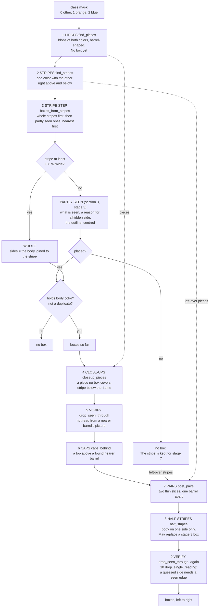
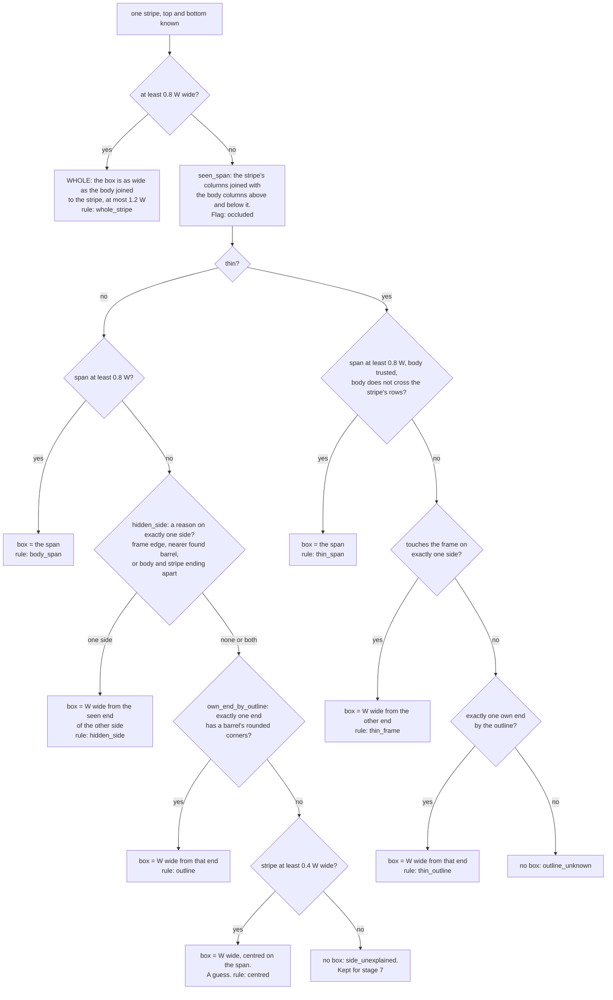

# DETECTOR-MAP.md — what `detect()` does, check by check

**Now (2026-11-27, after the collapse, its second pass, and the seam reading).** This is the map of `barrels/src/barrels/detector.py`. The detector has **no on/off switches**. It has 18 numbers (`DetConfig`) and ten stages, each one function. The collapse drew exactly the boxes the detector drew before it: 6152 boxes on 5435 masks, box for box (section 5). Since then one rule was adopted: **the second reading at the seams** (stage 2, checks 1 and 3; from the experiment `2026-11-26_slack`, rule D). It changes the boxes of 54 of the 5435 masks (section 5, last part). *Branch `wip/adopt-slack`: the walkthrough is owed, awaiting Tanush's "understood".*

**Also 2026-11-27: stage 11, the stripe by contrast** (`src/barrels/contrast.py`, `contrast.add_boxes`; from the experiment `2026-11-26_contrast`). It is not inside `detect(mask)`: it runs after it, on the picture itself, in `pipeline.detect_frame` (the photo-in, boxes-out path every caller uses). It finds a stripe that is bluer (or redder) than the body above **and** below it, paints that barrel in its own colors, runs `detect` again on the painted mask and **adds** the boxes that are on no box of the first run. `detect(mask)` itself is unchanged. Its checks and its 23 numbers: section 3, "Stage 11", and section 4.4. On the ordinary train frames: 135.4 → 156.6 of 172 placements, 63 barrels gained, none lost, no box on an empty frame (section 5, last part).

- Every name in `code font` is a function or a field of that file. There are no line numbers: search for the name.
- W = the width, H = the height, "a stripe height" = the stripe's height that the geometry expects of a barrel at the row in question.
- "edge tolerance" = 15 % of the height, at least 4 px (`edge_tol`).
- A word in quotes at the end of a check, like "too_far", is the reason the detector writes in its reason log when the check says no (`detect(mask, log=[])`).
- The map before the collapse, with the 30 switches, is `archive/DETECTOR-MAP-before-collapse-2026-11-26.md`. When each rule was added and for which frame: `archive/DETECTOR-HISTORY.md`.

---

## 1. Overview

The color step (`pipeline.py`, not the detector) makes every pixel orange, blue or other. The detector takes that mask and returns the boxes.

| # | stage | function | what it does, in one line | boxes |
|---|---|---|---|---|
| 1 | Pieces | `find_pieces` | blobs of orange and blue together, cut to barrel width, bottom edge from the top row, size checks | none yet: kept for stage 4 |
| 2 | Stripes | `find_stripes` | one color with the other color right above **and** right below; pieces joined; size checks; a wide stripe cut | none: makes stripes |
| 3 | Stripe step | `boxes_from_stripes` | one box per stripe. The stripe's row gives the distance, the distance gives the full box | **adds** (most boxes) |
| 4 | Close-ups | `closeup_pieces` | a stage-1 piece that no box covers is kept only when its stripe is below the frame | adds |
| 5 | Verify, pass 1 | `drop_seen_through` | drop a box that was read from a nearer barrel's own picture | **deletes** |
| 6 | Caps | `caps_behind` | a barrel-wide top showing above a found nearer barrel is a barrel behind it | adds |
| 7 | Pairs | `post_pairs` | two thin slices at the same rows, one barrel apart, are one barrel behind a post | adds |
| 8 | Half stripes | `half_stripes` | a stripe with body on one side only is a barrel hidden from above or from below | adds; may **replace** a stage-3 box |
| 9 | Verify, pass 2 | `drop_seen_through` | the stage-5 check again, on every box | deletes |
| 10 | Verify, readings | `drop_single_reading` | a box placed from a guessed side must have a seen top, bottom or full width | deletes |
| 11 | Stripe by contrast (after `detect`, in `pipeline.detect_frame`) | `contrast.add_boxes` | on the picture: a band bluer (or redder) than the body above and below it, at the size its row predicts; that barrel painted in its own colors; `detect` again; its new boxes added | **adds** only; never moves or drops a box of 1–10 |

Then the boxes are sorted left to right and returned. `detect` is the ten lines of stages 1–10 and nothing else. Stage 11 is not inside `detect`: `detect(mask)` is the mask-to-boxes stage, and stage 11 needs the picture.

Three things to keep in mind:

- **Stripes come first.** The first boxes come from stripes (stage 3). A stripe already needs body color above and below it, so "stripe" means "stripe sandwiched in body".
- **Geometry is not a stage.** It is the ruler inside every check. A row gives a distance. The distance gives the expected width, height and stripe height (`BarrelAt`). A check compares what is seen with that.
- **Occlusion is not a stage either.** It is one branch inside stage 3 (a stripe narrower than 0.8 W) and three add-on stages after it (6, 7, 8).



**Which rule draws the boxes.** On the 261 real train masks (boxes drawn, not barrels found; no labels read) the detector draws 243 boxes (239 before the seam reading). 205 come from a stripe (stage 3): 137 from a stripe seen whole, 28 where the body shows the width, 30 with one hidden side, 6 centred, 2 by the outline, 2 thin slices at the frame edge. 28 are close-ups (stage 4), 6 are caps, 4 are half stripes. No pair. `results/2026-11-27_adopt_slack/rule_counts.md` has the same count for the simulated scenes and the damaged masks, and how often each check says no (`results/2026-11-26_collapse/rule_counts.md`: the same before the seam reading).

---

## 2. The path of a plain, fully visible barrel

A barrel standing free, whole in the frame, body and stripe both painted. The numbers in brackets are for a barrel 20 cm away (51 px wide, 55 px tall, stripe 13 px, stripe centre at row 150) and 40 cm away (25.5 px wide, 28 px tall, stripe 6.8 px).

Before the detector, the color step must paint the body **and** the stripe.

Stage 1 finds this barrel's piece, but cannot refuse the barrel: a barrel with a stripe gets its box in stage 3, and the piece is then dropped as "covered".

| # | test, in plain words | number | function | if it fails |
|---|---|---|---|---|
| 1 | The stripe's pixels survive the clean-up. Both colors are closed (3 × 3). A stripe pixel inside the closed body is body. | `close_px` 3 | `sandwiches` | a very thin stripe vanishes |
| 2 | **The sandwich.** Every stripe pixel has body color above it **and** below it in its own column, near enough. | 3 × the stripe height expected at that row (`band_h_max`) [39 px; 20 px] | `sandwiches`, `_reach_by_row` | no stripe at all. This is the commonest real miss: the body is not painted |
| 3 | If a highlight cut the stripe, the pieces join into one. | same rows; together at most 1.2 W; each piece stripe-shaped, or the gap bridged by body color | `_join_pieces` | each piece is judged alone |
| 4 | Big enough. A smaller stripe gets one more chance at the seams (6) | 20 px (`min_area_px`) | `find_stripes` 1 | "area" |
| 5 | On the table. | W at least 16 px, i.e. nearer than 637 mm (`min_width_px`) | `on_the_table` | "too_far" |
| 6 | As tall as a stripe. | 0.45 to 1.6 × the stripe height [5.9–21 px; 3.0–10.8 px], from the 10th to the 90th percentile of its rows. Too thin (or too small) but the barrel seen whole: read once more at the seams, as the mean of its height and the gap between the two body parts (stage 2 below) | `find_stripes` 3, `read_at_seams`, `rest_of_barrel_agrees` | "height" |
| 7 | Not a speck sideways. | at least 0.45 × the stripe height wide [5.9 px] | `find_stripes` 4 | "width"; kept for stage 7 |
| 8 | Not wider than one barrel. | at most 1.4 W (`stripe_merge`); and at most 1.2 × W where body is seen right above and below | `_one_stripe_per_barrel` | it is cut into two barrels |
| 9 | Top and bottom. The body is walked up and down from the stripe. A seen end that agrees with the predicted row is the edge; else the predicted row is drawn. This refuses only when **both** edges are predicted **and** the body above ends against the other barrel color. | the edge tolerance [8.3 px; 4.2 px]; "against" = the 4 rows beyond the end, half of the stripe's columns | `read_edges` | "top_against_barrel" |
| 10 | Is the stripe at least 0.8 W wide? Yes: the box's sides are the body joined to the stripe. (No: the partly seen branch, also for a barrel that is not hidden.) | `stripe_full` 0.8 [41 px; 20 px]; the box at most 1.2 W (`body_width`) | `place_sides`, `_body_columns` | the partly seen branch |
| 11 | The box is not empty. | at least 2 × 2 px | `box_from_stripe` | "empty_box" |
| 12 | The box holds the body color. | in the stripe's columns, outside its rows: body pixels ≥ stripe-colored pixels, and body ≥ 10 % (`body_min`) | `holds_body` | "body_min" |
| 13 | It is not the same barrel as a surer box. | same color, IoU over 0.5; the box whose stripe holds more labeled pixels stays | `boxes_from_stripes` 4 | "duplicate" |
| 14 | It was not read from a nearer barrel's picture. Asked twice (stages 5 and 9). | at least 20 of its evidence pixels are not explained by a nearer kept barrel | `drop_seen_through` | "verify: front" |

Each test is a hard yes or no. None can make up for another. `drop_single_reading` does not ask this barrel anything: its box is not flagged "occluded".

After that the scorer asks for overlap ≥ 0.5 and the bottom edge within 10 % of the height (at least 3 px). The detector's own "agrees" in test 9 is 15 % (at least 4 px). See B8 in section 6.

---

## 3. The checks, stage by stage

Each check: **what it asks**; the number; what happens; *why it exists*.

### Stage 1 — Pieces (`find_pieces`)

In: the mask. Out: the pieces (`Piece`: a box, a color, flags, and the last row its own pixels reach). Only stage 4 uses them.

First the piece is made:

- **Which barrel-colored pixels touch?** Orange and blue together, gaps closed 3 × 3, touching diagonally counts, at least 20 px (`find_blobs`). *So a body and its stripe are one blob.*
- **How many barrels wide is the blob?** Its width ÷ the width W of one barrel at its bottom row (at its top row if it touches the frame bottom), rounded (`expected_width_px`). Two or more: cut at the narrowest column within ± 0.25 W of each equal cut (`split_blob`). *Touching barrels meet at their bulges, so there is a waist.*
- **Is the seen bottom where the top row says the base must be?** Within the edge tolerance: the seen bottom is kept. Else the predicted bottom is drawn, flag `bottom_inferred` (`predicted_bottom`, `resolve_bottom`). The box is clipped to the frame; at the frame bottom it is `truncated`. *A shaded lower face makes the blob short.* A piece whose top is at row 232 or lower always gets a box to the frame bottom: its predicted base is below the frame.

Then four checks, numbered as in `find_pieces`:

1. **Is it on the table?** W at its bottom row is at least 16 px. No: "too_far". *The hand at the horizon.*
2. **Is its top below the horizon?** (`above_horizon`) No: "above_horizon". *A barrel is 24 mm tall and the camera is 43 mm up, so the camera looks down on every lid. Nothing on the table has its top at or above the horizon. A jacket above the table edge does.*
3. **Is it barrel-wide?** 0.4 to 1.6 × W. No: "width".
4. **Is it far too short?** Asked only when the box ends inside the frame and does not touch the frame top: under 0.5 × H for its bottom row (`height_min`). Yes: "height". *The case: a top in the lowest rows of the frame (row 427 or lower). There the top row predicts no bottom, because the base would be at or behind the camera. A barrel that near runs out of the frame bottom; a piece that ends inside the frame there is not one.* Everywhere else the bottom was seen or drawn where the top row predicts it, so the height already fits. No piece is too tall (at most 1.1 × H), so no upper limit is asked (section 5, B13).

Its color is the majority of its pixels. A tie is orange.

### Stage 2 — Stripes (`find_stripes`)

Done twice: orange as the body (blue stripes), then blue as the body. In: the mask. Out: the stripes (`Stripe`) and the **left-over pieces**.

First the sandwich (`sandwiches`, computed once per image and used again by stage 8): a pixel of the other color counts when body color is above **and** below it in its own column, within 3 stripe heights (`band_h_max`). Connected pixels are a piece. Then:

- **Join** (`_join_pieces`). Going left to right, a piece joins the nearest group to its left when they share rows (`same_rows`), together fit in one barrel (1.2 W), and either both are stripe-shaped (not taller than wide, not taller than 1.6 stripe heights) or the gap between them is **bridged**: both no taller than 1.6 stripe heights, box middles within half a stripe height, body color above and below in **every** column of the gap, gap at most half the joined span. *A highlight or a slit cuts a stripe in pieces. Two barrels cannot both have their stripe inside one barrel's width at the same rows.*

Per stripe, in this order:

1. **Big enough?** 20 px. Under 20: read again at the seams (below); it passes if its pixels, scaled by seam height ÷ own height, reach 20. No: "area". (So 1 is decided after 2: the second reading needs the row.)
2. **On the table?** (`on_the_table`) W at least 16 px. No: "too_far" ("area" for one under 20 px).
3. **As tall as a stripe?** 0.45 to 1.6 × the stripe height, measured from the 10th to the 90th percentile of its rows. Too thin, and the barrel seen whole: read a second time at the seams (below). No: "height".

**The second reading, at the seams** (`read_at_seams`, `rest_of_barrel_agrees`; adopted 2026-11-27 from `2026-11-26_slack`, rule D). Asked of a stripe that is too thin (3) or too small (1) by its own pixels, and not too tall.

```
the stripe's own height h (10th to 90th percentile of its rows); the gap g between the body above and the body below
  (median over its pixels)
├─ each color lost e = (g − h) ÷ 4 px at each seam; e at least 0, at most 3 px (SEAM_MAX_EATEN)
├─ the seam height = h + 2e = the mean of h and g
├─ is the barrel seen whole?
│    a stripe with 20 px or more (too thin only):
│        its width with the eaten pixels given back, bw + 2e, at least 0.8 W (stripe_full)
│        OR the rest of the barrel agrees (with e given back at the two ends)
│    a stripe under 20 px: ONLY the rest of the barrel agrees, its ends as seen (e = 0)
│  the rest of the barrel agrees (rest_of_barrel_agrees):
│    ├─ the body walked up and down from the band ends where the row predicts the top and the bottom (the edge tolerance)
│    ├─ neither end lies against the other barrel color (the 4 rows beyond it, half the columns)
│    └─ on at least one side the stripe and the body joined to it end together (within the edge tolerance of W):
│       that side is the barrel's own edge
├─ not seen whole → the stripe is judged by its own pixels, as before ("height" / "area")
└─ seen whole, and the seam height is 0.45 to 1.6 stripe heights →
     passes 3; passes 1 when area × seam height ÷ h ≥ 20; from then on its box is the band from body to body;
     a stripe under 20 px carries its pixel count (Stripe.own_px) to the verify step
```

*Mixed pixels at the two seams make the stripe thinner and the gap taller by the same amount.* One pixel shaved off every color makes a stripe 5 rows tall 3 rows tall, under the floor, **and** 0.65 to 0.73 of a barrel wide, under the 0.8 the old width test wanted, both at once. The top and bottom of the barrel are a second witness that does not lean on the stripe's own pixels. *A stripe under 20 px called "seen whole" by its width alone drew four boxes on nothing on the train frames with hand-set colors (bathroom tile, the warm ottoman): so a small stripe needs the rest of the barrel.* *A blue sliver between two fingers, skin above and below:* the skin runs on past both ends of the sliver, so no side is a barrel's own edge: not read again.
4. **Wide enough to look at?** At least 0.45 × the stripe height. No: "width", and the piece becomes a **left-over piece**.
5. **Wider than one barrel?** (`_one_stripe_per_barrel`) Over 1.4 W: cut into round(width ÷ W) equal parts. Or, where body is seen right above **and** below the whole region: over 1.2 × W₂, cut into at least two parts. W₂ is the larger of W and the width of a barrel as tall as that body. Each part remembers the region (`Stripe.cut_from`). *Two same-colored barrels side by side have one joined stripe. A near barrel runs wider than its row predicts, but then it is taller too.*
6. **Thin?** Narrower than one stripe height, or taller than wide: marked `Stripe.thin`. It enters stage 3 **and** a copy goes to the left-over pieces.

"Does its row give a distance?" is not asked. It always does: a stripe's pixels sit only at rows where a barrel can have its stripe (section 5, C1).

### Stage 3 — One box per stripe (`boxes_from_stripes`, `box_from_stripe`)

In: the stripes. Out: the boxes (`Found`), the stripes nothing could place (for stage 7), and the stripes that lost to a surer box (for stage 6).

**Order.** Stripes at least 0.8 W wide first, left to right. Then the narrower ones, lowest stripe row (nearest) first. *A partly seen stripe asks about the barrels found so far.*

Per stripe, four steps, numbered as in `boxes_from_stripes`:

1. **(partly seen, not cut from a wider stripe) Is it a second piece of a found barrel's stripe?** Same body color, shares rows with that barrel's stripe, its middle column inside that barrel's box (`piece_of_found`). Yes: no box, "stripe_piece".
2. **Make its box** (`box_from_stripe`, three steps of its own):
   1. **Where are the top and the bottom?** (`read_edges`) The body is walked up and down from the stripe in the stripe's columns; the walk ends after 3 empty rows (`_body_extent`). A seen end within the edge tolerance of the predicted row is the edge. Else the predicted row is drawn and flagged `top_inferred` / `bottom_inferred`. Then two questions, because an edge is only seen against something that is not a barrel:
      - (a) **Both edges predicted, and the body above ends against the other barrel color?** (`ends_against`: that color in half of the stripe's columns, in the 4 rows beyond the end.) Yes: no box, "top_against_barrel". *A strip of a back barrel between its own stripe and a front barrel is not a barrel.*
      - (b) **A seen bottom that ends against the other barrel color, with the predicted bottom lower?** Yes: the predicted bottom is drawn. *The barrel may go on behind the one in front.*

      **A thin stripe must be a slice seen from top to bottom:** neither edge predicted. Else no box, "slice_not_full". *A reason for a hidden side says where a barrel would be, not that there is one.*
   2. **Where are the left and the right?** (`place_sides`) See the tree below. Nothing places it: no box, "side_unexplained" (thin: "outline_unknown"). A stripe that is not thin is then kept for stage 7.
   3. **Is the box at least 2 × 2?** No: "empty_box". **Does it hold the body color?** (`holds_body`) In the stripe's columns, outside its rows: body pixels ≥ stripe-colored pixels, and body ≥ 10 %. No: "body_min". *A blue barrel's body between two orange things is not an orange barrel.*
3. **Would the box sit on a found box** (`same_barrel`: same color, IoU over 0.5)? A box the outline placed never takes a found box's place. A thin stripe: no box, "duplicate". Any other: the box is made again without the outline (`use_outline=False`).
4. **Is it the same barrel as a found box** (and not another part cut from the same wide stripe)? The surer one stays: confidence = 0.5 + 0.5 × the labeled share of the stripe's box. "duplicate". The stripe of the box that goes is "lost": stage 6 still treats it as a stripe. In the log, "kept" is written when a box goes into the list, and "duplicate" for the box that goes.

**The sides (`place_sides`).**



- **Whole** (`_body_columns`). A column counts with 2 or more body pixels. Gaps of 2 columns are allowed. Columns under another stripe never count (thin stripes are not "another stripe"). *The stripe's outermost pixels curve away and go dark, so the stripe alone runs 15 % narrow.*
- **What is seen** (`seen_span`, `_body_span`). The stripe's columns joined with the body columns above and below it. If that is wider than 1.2 W, a same-colored neighbour is in it: the body is "not trusted" and only the stripe counts. A side is **cut** when the body's end and the stripe's end there are further apart than max(4 px, 15 % of **W**). A part cut from a wider stripe is cut on its cut side. *At a barrel's own edge the stripe and the body end together.*
- **A reason for a hidden side** (`hidden_side`). The span touches the frame edge there; or a found barrel standing nearer is there (its box holds one of the 3 pixels beside the span at the stripe's middle row, and its bottom is lower than this barrel's predicted bottom); or the side is cut.
- **The outline** (`own_end_by_outline`, `_end_costs`, `Outline`). Each end of the span is asked alone. Put the barrel's outline with its side on that end. Over the columns within 0.353 W of the end, compare the seen top line, stripe line and bottom line with the outline's. The end's cost is the largest of the three mean differences, in barrel heights. An end costing at most 0.05 (`pin_good`) is the barrel's own side. *A barrel's own side has rounded corners. A cut side has square ones.*
- **Thin stripes** (`thin_slice`) skip the reasons. They get here only as a slice seen from top to bottom (`box_from_stripe`, step 1).
- Only the exits "hidden_side", "outline" and "centred" guess a side. `drop_single_reading` asks them again at the end.

### Stage 4 — Close-ups (`closeup_pieces`)

In: the stage-1 pieces and the boxes so far. Out: more boxes (source "det1").

1. **Does a box already account for this piece?** They share more than 0.3 of the narrower one's width, **and** they share rows. A piece kept just before counts too. Yes: "covered". *A far barrel standing above a close-up in the picture must not hide it.*
2. **Is it a close-up?** Its box reaches the frame bottom (rule "closeup"). Or its top row puts the stripe's bottom edge at or below the frame bottom: top at row 241 or lower (rule "closeup_stripe"; `_closeup_stripe_rows`). *The frame cuts the stripe, so no body shows below it and the stripe finder cannot see it.* Neither: "stripeless". *Its stripe would be in view, and the stripe stages found no barrel there.*
3. **A close-up that the left or right frame side also cuts: is its body seen down to where its top row puts the stripe (or to the frame bottom)?** Within the edge tolerance (`_seen_to_stripe`). No: "closeup_side". *A printed orange fruit at the frame corner. With the side cut, the width says nothing.*
A close-up that passes 3 is a box. "Too far away to show a stripe" is not a way to be kept without one: no piece on the table is that far (section 5, B1).

Nothing here asks whether the piece is a solid face (B10).

### Stages 5, 9 and 10 — Verify (`drop_seen_through`, `drop_single_reading`)

**A barrel cannot be seen through a nearer barrel** (`drop_seen_through`; stage 5 and stage 9).

```
fewer than 2 boxes → nothing to do
boxes taken nearest first (lowest bottom edge first)
for each box b:
├─ its evidence = the box of what it was read from: its stripe, its cap piece, its band,
│    its two slices together; a piece is its own (Found.evidence_box)
├─ nearer = the kept boxes whose bottom edge is strictly lower than b's
├─ each nearer barrel explains the pixels of its own layout (outline_layout): body color in its body rows,
│    stripe color in its stripe rows, either color within half a stripe height of a seam;
│    only in the rows where its body is seen
├─ own pixels = barrel-colored evidence pixels that no nearer barrel explains
└─ a nearer barrel exists and own pixels < 20 (min_area_px) → dropped: "verify: front"
     (a stripe admitted at the seams with fewer than 20 px: < its own pixel count, Stripe.own_px)
```

*A nearer barrel's upper body between clutter above and its own stripe below reads as the stripe of a smaller barrel behind.* It runs before the caps so that stages 6 to 8 lean only on boxes that passed. A dropped box's stripe is cap material again.

**A guessed side needs a second reading** (`drop_single_reading`; the last stage).

```
only for a box from a stripe (source det2) flagged occluded, with top AND bottom both predicted
├─ W from the middle row of its stripe's box
├─ seen span = the stripe's columns joined with the body columns; wider than 1.2 W: only the stripe's
└─ seen span under 0.8 W → dropped: "verify: readings"
```

*A tin with an orange lid and a blue label: a piece of the label made a box from one stripe row and nothing else.* Caps, pairs, half stripes and thin stripes always have a seen edge by the way they are made.

### Stage 6 — Caps (`caps_behind`, `_cap_pieces`, `_cap_box`)

A barrel behind a found barrel shows its upper body (its "cap") above it. Its stripe has melted into the front barrel's body, so stage 3 cannot find it. The distance comes from the cap's **top row**. Done per color. Out: boxes (source "det3", flags `occluded` and `bottom_inferred`, confidence 0.5).

```
that color's pixels (closed), without the boxes of the stripes already read
a connected piece of 20 px or more:
├─ fewer than half of its pixels inside found boxes of its color → a candidate
│    else → only its parts outside those boxes are candidates        (a barrel behind one of its own color)
├─ 1. top row readable (not at the frame top), on the table?         no → dropped, no note
├─ 2. 0.4 to 1.2 W wide?                                             no → "width"
├─ 3. 0.4 of an upper body to one upper body + the edge tolerance tall?   no → "height"
├─ 4. at least 0.8 W wide → bottom = top + the height of a barrel as wide as the cap
├─ 5. narrower → exactly one side hidden (the frame edge, or a found box beside it whose bottom is lower than the cap's)?
│         neither → "narrow"        both → "both_sides"
│         one → widened to W toward that side; bottom = the one the top row predicts
├─ 6. its own color seen ending within the edge tolerance of that bottom (3 empty rows after)?  yes → that end is the bottom
├─ 7.   no, and the cap is narrow → seen ending beside the nearer found barrels, between the bottom of a barrel
│         only as wide as the cap and the estimate + the tolerance?  yes → that end is the bottom
├─ 8. at least half of the box below the cap inside found boxes whose bottom is lower than this box's?   no → "not_hidden"
└─ 9. not the same barrel as a found box or an earlier cap → box       else "duplicate"
```

*Why 4 uses the width: the bottom predicted from the top row is 4 to 7 px low at mid and far range with this camera.* "Standing nearer" means a different bottom at 5, 7 and 8 (B4).

### Stage 7 — Pairs (`post_pairs`, `_full_slice`)

In: the left-over pieces of stage 2 and the stripes stage 3 could not place. Out: boxes (source "det2", flag `occluded`, confidence 0.5).

1. **Is the piece a second piece of a found barrel's stripe?** (`piece_of_found`) Yes: left out.
2. **Is it a full slice?** The body above and below ends where its row predicts the top and the bottom (edge tolerance), and neither end lies against the other barrel color. No: left out.
3. **Is it narrow?** Under 0.4 W (`stripe_w_min`). No: left out.
4. **Two such pieces: same body color, the right one wholly right of the left one, same rows?**
5. **Are their outer body edges one barrel apart?** 0.8 to 1.2 × W. Yes, and not the same barrel as a found box: one box from outer edge to outer edge.

*A post over the middle of a barrel. Two barrels at one distance cannot have their outer edges within 1.2 W of each other.* No real train frame forms a pair.

### Stage 8 — Half stripes (`half_stripes`)

A band = a connected piece of one color, 20 px or more. The distance comes from the **seam** between band and body. Out: boxes (source "det2", flags `occluded` and `top_inferred` or `bottom_inferred`, confidence 0.5).

```
├─ 1. body right below in ≥ 0.8 of its columns and right above in ≤ 0.2 → "top hidden"
│       body right above in ≥ 0.8 and right below in ≤ 0.2              → "bottom hidden"       else → not a half stripe
├─ 2. the seam gives the distance (15 mm above the table for the stripe's top edge, 9 mm for its bottom edge);
│       on the table?                                               no → skipped
├─ 3. band not taller than 1.6 stripe heights (no floor)             no → "height"
├─ 4. band 0.8 to 1.2 W wide                                         no → "width"
├─ 5. the body's far edge where the seam predicts it, inside the frame   no → "far_edge"
├─ 6. band thinner than the body part beside it                      no → "thicker_than_body"
├─ 7. body 0.8 to 1.2 W wide                                         no → "body_width"
├─ 8. open side clear: barrel color in the 4 rows beyond the band in under half of its columns   no → "open_side"
├─ 9. far edge not against barrel color                              no → "far_edge_against_barrel"
├─ 10. not a found barrel's (under half of the band inside found boxes; no found box of its color with IoU over 0.5)   no → "found"
└─ box: sides and far edge as seen, hidden edge where the seam's distance puts it.
        A stage-3 box (flag occluded) whose stripe lies inside this band's box is a corner of it: it does not count
        as "found" in 10, and the new box REPLACES it.
```

*A book lying in front of a barrel, or something hanging over it.* A half stripe always shows its whole width. No side is guessed.

### Stage 11 — The stripe by contrast (`contrast.add_boxes`, in `pipeline.detect_frame`; 2026-11-27)

In: the picture (RGB), the fixed colors' class mask, and the boxes of stages 1–10. Out: those boxes, plus the ones this stage adds (source "contrast"). It never moves or drops a box. It is for the barrel the fixed colors miss: under a warm or dim lamp one of a barrel's two colors falls outside its fixed range, and stages 1–10, which need both, see nothing. The question it asks does not need the colors: *is this band bluer (or redder) than what is right above it AND right below it, at the size its row predicts?* A change of light shifts all three bands alike, and the difference cancels it.

```
├─ 0. the channel, per pixel: log((R + 8) / (B + 8)); a pixel darker than 25 or with a channel at 250 or more is left out
├─ 1. for every row taken as a stripe's middle, the geometry gives that barrel's stripe rows, body rows and width
│       (rows above row 50, a stripe under 4 px, a barrel under 16 px wide: not searched)
│     three bands in each column: the middle 0.6 of the stripe rows; above and below, starting 0.25 stripe heights
│       out and 0.9 stripe heights tall (never past the barrel's own top and bottom); each band needs half its pixels usable
├─ 2. the sandwich: the smaller of (above − stripe) and (below − stripe) when both have one sign, else 0.
│       Positive = a band bluer than both: an ORANGE barrel's blue stripe. Negative = redder: a BLUE barrel's orange stripe
├─ 3. a candidate: in at least half (0.5) of a window 0.8 W wide, the sandwich passes 0.5,
│       AND its mean over the window (the strength) is at least 1.15                         no → nothing here
│     strongest first, at most 20 a frame; its middle moved to the middle of its stripe (rows, then columns; touching
│       barrels of one color share one long stripe: one slot per barrel); a weaker one inside a stronger one's box dropped
├─ 4. its stripe point lies inside a box of stages 1–10                                   yes → "found_already": left alone
├─ 5. its own colors: the body = the median of its two body bands, the stripe = its stripe band (middle 60 % of the width),
│       as (log R/G, log B/G, 0.5 × log brightness); d = how far apart they are               a band unreadable → "unreadable"
├─ 6. the orange part reads reddish at all: channel ≥ 0.8 (an orange barrel's body, a blue barrel's stripe)  no → "orange_min"
├─ 7. the barrel ends where its row says: what is right above the top differs from the body by ≥ 0.15 d   no → "extent_top"
│                                            ... and what is right below the bottom                       no → "extent_bottom"
├─ 8. paint, inside the predicted box grown 8 %, only where the fixed colors painted nothing: a pixel is body when the body
│       color is the nearest of (body, stripe, the things around the box that differ from both by ≥ 0.35 d) and nearer than
│       0.6 d; stripe likewise, and only within 0.75 stripe heights of the stripe rows
└─ 9. if anything was painted: detect(painted mask) with the same DetConfig; each of its boxes that is on NO box of
        stages 1–10 (half of the smaller box inside the other, `counting.is_on`) is added. The rest of its boxes are dropped.
```

*Worked example, `4A8B_lampmid6_bathtile_core_01` (train, bathroom floor, mid lamp): the fixed colors find none of its four barrels.* Four candidates, strengths 2.07, 1.81, 1.75, 1.69 (all above 1.15); the orange part reads 1.66 to 1.81 (above 0.8); above and below the boxes 0.39 to 0.74 d (above 0.15). All four are painted (162 to 4206 pixels), stages 1–10 box all four on the painted mask, and all four are added. Against the hand boxes all four are found.

*Why add and not merge.* Painting into the fixed mask and taking the second run's whole answer failed its judge (experiment C2): second boxes on barrels already found, and boxes on the glass table's jar. *Why the two checks.* Without them the stage draws boxes on clutter: the blue tin's "orange body" is not reddish (6), and a band of color that goes on past the predicted top or bottom is not a barrel's end (7). The strength floor 1.15 is the sharpest number: a red jar with a teal label reads 1.09.

*What it cannot do.* A barrel with no visible stripe (close-ups whose stripe is below the frame, tipped barrels). Very dark scenes (the black ottoman: the pixels are under 25). A thing that really is orange with a blue band at barrel size (the jar on the glass table under the warm lamp). A barrel inside a wrong box of stages 1–10 is left alone (step 4).

---

## 4. Every number that is left

### 4.1 `DetConfig`: 18 numbers, no switches

| name | value | what it means | where it is used |
|---|---|---|---|
| `min_area_px` | 20 | a speck | a blob (`find_blobs`), a stripe (`find_stripes` 1; under it, only the rest of the barrel may call it seen whole), a cap piece (`_cap_pieces`, `_cap_box`), a half-stripe band; and the "own pixels" limit of `drop_seen_through` (a stripe admitted under it: its own pixel count) |
| `close_px` | 3 | the closing: 3 × 3 | `_closed` (blobs, the sandwich, caps). Also, unrelated: how many pixels beside a seen end are searched for a nearer barrel (`hidden_side`) |
| `bottom_tol` | 0.15 | the edge tolerance, as a share | `edge_tol`: of the height at 8 sites (`resolve_bottom`, `_seen_to_stripe`, `read_edges`, `_end_costs`, `_cap_box`, `_full_slice`, `half_stripes`, `rest_of_barrel_agrees`); of the **width** at 2 (`seen_span`: body and stripe ending apart; `rest_of_barrel_agrees`: they end together) |
| `bottom_tol_min_px` | 4 | its floor | `edge_tol` |
| `width_min` | 0.4 | narrower × W is a sliver | a piece (`find_pieces` 3), a cap (`_cap_box` 2). Also a cap's least **height**, × an upper body (`_cap_box` 3) |
| `width_max` | 1.6 | wider × W is not one barrel | a piece (`find_pieces` 3) |
| `split_search` | 0.25 | where a blob's waist is looked for, ± × W | `split_blob` |
| `min_width_px` | 16 | a barrel narrower than this is beyond the table | `find_pieces` 1, `on_the_table` (stripes, caps, half stripes) |
| `stripe_h_min` | 0.45 | a stripe's least height, × the stripe height | `find_stripes` 3. Also a stripe piece's least **width**, × the stripe height (`find_stripes` 4) |
| `stripe_h_max` | 1.6 | a stripe's greatest height, × the stripe height | `find_stripes` 3, `half_stripes` 3, "stripe-shaped" in `_join_pieces` |
| `band_h_max` | 3.0 | "right above / right below": within this × the stripe height | `_reach_by_row` (the sandwich: stages 2 and 8) |
| `stripe_w_min` | 0.4 | × W | the least stripe for the centred guess (`centred`); the widest slice of a pair (`post_pairs`) |
| `stripe_merge` | 1.4 | a stripe region wider × W is several barrels | `_one_stripe_per_barrel` |
| `stripe_full` | 0.8 | "the whole width shows", × W | whole or partly seen (`place_sides`, the order of stage 3); "seen whole by its width" in the reading at the seams (`find_stripes` 3, with 2 × the eaten pixels given back); the seen span (`seen_span`, `drop_single_reading`); a cap (`_cap_box` 4, 7); a pair's span; half stripes (the shares 0.8 and 0.2, and the widths) |
| `height_min` | 0.5 | a piece shorter than this × H is far too short to be a barrel | `find_pieces` 4 |
| `body_min` | 0.1 | the least share of body color in the box | `holds_body` |
| `body_width` | 1.2 | one barrel is at most this × W wide | the box (`place_sides`), the trusted body (`seen_span`, `drop_single_reading`), a joined stripe (`_join_pieces`), the second cut of `_one_stripe_per_barrel`, a cap, a pair, a half stripe |
| `pin_good` | 0.05 | an end is the barrel's own side when the outline's lines lie within this × H | `own_end_by_outline` |

Seven numbers do more than one job: `stripe_full`, `body_width`, `bottom_tol`, `close_px`, `min_area_px`, `width_min`, and `stripe_h_min`. None can be changed for one job without moving the others.

### 4.2 Numbers that are not in `DetConfig`

| number | what it decides | where |
|---|---|---|
| touching diagonally counts (8-connected) | what is one piece | `find_blobs`, `find_stripes`, `_cap_pieces`, `half_stripes` |
| a tie is orange | a piece's color | `find_pieces` |
| a quarter | the stripe's centre row is the median row of its colored pixels when they are at least a quarter of the part, else the box middle | `_one_stripe_per_barrel` |
| 10th to 90th percentile of the rows, + 1 | "the stripe's height" | `find_stripes`, `_join_pieces`, `half_stripes` |
| overlap at least half the shorter height | "the same rows" | `same_rows` (join, `piece_of_found`, pairs) |
| middles within ½ stripe height; gap ≤ ½ the joined span; body in every gap column | the bridge | `_join_pieces` |
| equal weights ½ and ½ | the second height reading: the mean of the stripe's height and the gap | `read_at_seams` |
| (gap − height) ÷ 4, at least 0, at most 3 px (`SEAM_MAX_EATEN`: the 3 empty rows the body walk allows) | the pixels eaten at each seam | `read_at_seams` |
| area × seam height ÷ own height ≥ 20 | a small stripe read at the seams is big enough | `find_stripes` 1 |
| 3 empty rows end the walk | where the body ends, up and down | `_body_extent` (also in `rest_of_barrel_agrees`), `_seen_lines` |
| 2 body pixels make a column; 2 empty columns end the walk | where the body ends, sideways | `_body_columns`, `_body_span` |
| 0.353 W; the side curve 1 − √(1 − t) | the barrel's outline: the lid's half width, the shoulder | `LID_HALF`, `Outline` |
| the columns within 0.353 W of the end; at least 2; the worst of the three lines; each line's median taken out | the own-side test | `_end_costs` |
| more than half of the stripe's rows | "the body crosses the stripe" | `_body_crosses` |
| the 4 rows beyond the edge; half of the columns | "ends against" | `ends_against` (`read_edges`, `_full_slice`, `rest_of_barrel_agrees`), and the open side of `half_stripes` |
| body pixels ≥ stripe-colored pixels | the first half of the body check | `holds_body` |
| 0.5 + 0.5 × the labeled share; a fixed 0.5 for caps, pairs, half stripes | "confidence", used only to pick the surer of two stripe boxes | `box_from_stripe` |
| IoU over 0.5, same color | "the same barrel" | `is_same_barrel` |
| more than 0.3 of the narrower width, and any shared row | "covers" | `closeup_pieces` 1 |
| half of the pixels; half of the box below | a cap candidate; "hidden by a barrel" | `_cap_pieces`, `_cap_box` 8 |
| 3 empty rows after it | a cap's seen bottom | `_cap_box` 6, 7 |
| 15 mm and 9 mm | the seam heights of a half stripe | `half_stripes` |
| within half a stripe height of a seam, either color | what a nearer barrel explains | `outline_layout` |
| a strictly lower bottom edge | "nearer" | `standing_nearer`, `drop_seen_through` |
| 12.75 + 1 mm | the nearest a barrel's axis can be | `BarrelAt` |
| 2 px | the smallest box | `box_from_stripe`, `half_stripes` |
| 4 px (`THINNEST_STRIPE_PX`) | a fact, not a setting: the stripe of a barrel on the table is at least this tall. It is asserted; nothing is refused by it | `on_the_table` |

### 4.3 Where one idea still has several numbers

The collapse put each idea in one helper but did **not** make the numbers the same. That would change boxes (section 6).

| idea | the numbers today |
|---|---|
| "wider than one barrel" | 1.5 W (the blob's count rounds to 2), 1.6 W (`width_max`), 1.4 W (`stripe_merge`), 1.2 W (`body_width`) |
| "a barrel standing nearer" | a found box's bottom lower than: this barrel's **predicted** bottom (`hidden_side`); the cap piece's **seen** bottom (`_cap_box` 5, 7); the cap box's **drawn** bottom (`_cap_box` 8); the other **box's** bottom (`drop_seen_through`) |
| "beside" | 3 pixels beside the span (`hidden_side`); 1 pixel beside the cap (`_cap_box` 5) |
| "ends against" | the **other** barrel color (`read_edges`, `_full_slice`, `rest_of_barrel_agrees`); **any** barrel color (`half_stripes` 8, 9) |
| the row that gives a stripe's barrel | the median row of the candidate's pixels (`find_stripes`); the stripe's centre row (stage 3, `Stripe.at`); the middle of a piece's box (`_join_pieces`); the middle of the stripe's box (`drop_single_reading`) |
| "the same rows" | overlap at least half the shorter (`same_rows`); middles within half a stripe height (the bridge); any overlap (`closeup_pieces` 1) |
| "the seen edge agrees" | 15 %, at least 4 px (the detector); 10 %, at least 3 px (the scorer, `eval_det.py`) |
| "the barrel is seen whole" | the stripe 0.8 W wide (`place_sides`; at the seams with the eaten pixels given back); the body's top and bottom where the row puts them and one side ending with the stripe (`rest_of_barrel_agrees`); a full slice (`_full_slice`: top and bottom only) |

### 4.4 `ContrastConfig`: the 23 numbers of stage 11, no switches

The setting the experiment's fold rule picked on all eight places (`experiments/2026-11-26_contrast`, branch `wip/exp-contrast`). In the judged run each held-out place had its own pick from the other seven; five of eight picked exactly this, and the strength floor 1.15, the absolute check and the extent check were picked in every fold that used them (the other three folds added a check that is not in the code). "d" = how far apart this barrel's own body color and stripe color are.

| name | value | what it means | where it is used |
|---|---|---|---|
| `offset` | 8 | log((R + 8) / (B + 8)): two nearly black values do not give a wild ratio | `channel` |
| `v_min` | 25 | a pixel darker than this is left out of every band | `usable` |
| `clip` | 250 | a pixel with a channel at or above this (glare) is left out | `usable` |
| `band_valid` | 0.5 | a band counts when half its pixels are usable | `band_means` |
| `core` | 0.6 | the stripe band = the middle 0.6 of the predicted stripe rows | `row_bands` |
| `gap` | 0.25 | the body bands start this many stripe heights beyond the stripe ... | `row_bands` |
| `body` | 0.9 | ... and are this many stripe heights tall | `row_bands` |
| `margin` | 0.5 | a column passes when both body bands differ from the stripe band by more than this, one sign | `respond` |
| `width_share` | 0.5 | at least this share of the window passes | `find` |
| `window` | 0.8 | the window is this × W wide | `row_bands` (`half`) |
| `strength_min` | 1.15 | the mean difference over the window is at least this | `find` |
| `min_stripe_px` | 4 | rows whose stripe would be thinner are not searched (the same 4 px as the detector's `THINNEST_STRIPE_PX`, kept apart) | `row_bands` |
| `min_width_px` | 16 | rows whose barrel would be narrower are not searched (= `DetConfig.min_width_px`) | `row_bands` |
| `top_row` | 50 | no stripe point above the color step's row gate | `row_bands` |
| `max_candidates` | 20 | at most this many candidates a frame, strongest first | `find` |
| `orange_min` | 0.8 | the orange part reads at least this in the channel | `measure` ("orange_min") |
| `extent` | 0.15 | above the top and below the bottom differ from the body by at least this × d | `measure` ("extent_top", "extent_bottom") |
| `feat_offset` | 8 | the same offset in the own-color comparison | `features` |
| `bright` | 0.5 | the weight of brightness against color there | `features` |
| `box_slack` | 0.08 | the paint box = the predicted box grown by this share | `paint` |
| `match` | 0.6 | a pixel is a color when nearer than this × d | `paint` |
| `distinct` | 0.35 | a thing around the box counts as "something else" when this × d from both colors | `paint` |
| `stripe_zone` | 0.75 | stripe paint only within this many stripe heights of the stripe rows | `paint` |

Fixed in the code, not in `ContrastConfig`: the middle 60 % of the width for the own colors (`measure`), the four cells around the box (`measure`), 0.9 for "a flat top" when a candidate is moved to its stripe's middle (`_recentre_row`, `find`), 1.2 W for "one stripe or the shared stripe of touching barrels" (`_recentre`), the quarter width and tenth height by which a candidate's box swallows weaker ones (`find`). The experiment's other switches (an opponent channel; the checks "own colors apart", "one body", "a side differs") were not picked and are not in the code; they are on branch `wip/exp-contrast`.

---

## 5. What the collapse removed, and why it is safe

Before: 1904 lines, 51 `DetConfig` fields (30 on/off switches read at 63 places, 20 numbers, 1 mode). After the collapse: 1825 lines, 20 numbers. After its second pass, which took out what was proved dead (below): 1823 lines, 18 numbers. The file is not much shorter: about 420 lines of switches and dead code went, and the docstrings that now say what each check asks came in.

| step | what went or changed | why no box can change |
|---|---|---|
| A1 | the 7 switches that were off (`dark_stripe`, `occl_body_side`, `slice_box`, `cover_unpinned`, `stripe_two`, `slice_behind`, `own_close`), the "bands" finder, and their code | every line sat behind an `if` that was false |
| A2 | the 23 switches that were on are plain code; step 1 alone (`detect_step1`, `--step1`) is gone | every `if` was true |
| A3 | `detect` is ten named stages; the partly seen branch is small functions | code moved |
| A4 | one helper per idea (`edge_tol`, `same_rows`, `same_barrel`, `ends_against`, `standing_nearer`, `widest_barrel`, `sandwiches`; `widest_barrel` went in the second pass) | each is called with the number its site had |
| A5 | `BarrelAt`: the geometry's barrel, built once per stripe | same row in, same numbers out |
| A6 | each box carries its evidence (`Found`); the verify stages no longer search the reason log | not certain in advance; the check decided |
| A7 | the horizon fact is a check of its own (`above_horizon`) | not certain in advance; the check decided |
| A8 | three clauses that never decide are gone | argued below |
| A9 | the history is out of the comments (`archive/DETECTOR-HISTORY.md`) | comments |

**The proof.** The detector is a pure function of the mask and the camera. So 5435 masks were fixed before the first change: every train frame as the color step paints it (261), each with one pixel eroded and dilated (522), the 45 frames with hand-set thresholds, the 53 masks the occlusion scorecard is built from, 666 damaged masks and all 3888 simulated occlusion scenes. No test frame. The detector before the collapse draws 6152 boxes on them. After **every** step the detector drew the same 6152 boxes: same color, box, flags, source and confidence, in the same order. The scripts and the boxes are in `experiments/2026-11-26_collapse/` and `results/2026-11-26_collapse/`.

The reason logs are the same too, except in one step, A7. On 224 of the 5435 masks a piece with its top above the horizon is now refused as "above_horizon" where the log said "height" (473 notes) or "width" (22 notes) before. They are the same pieces, refused one check earlier.

**A7, the horizon.** Before, nothing said "a barrel's top is below the horizon". A piece with its top above the horizon has no distance from its top row. The close-up rule read "no distance" as "the stripe is below the frame" and would have boxed it. What stopped it was the height check, written for one jacket: such a piece is always more than 1.5 × too tall for its bottom row (1.63 × or more, for every pair of rows). Now `find_pieces` asks the fact itself (its check 2), and the close-up rule no longer reads "no distance" as "below the frame". One case differs in theory: a piece that touches the **frame top** skipped the height check before, so it could pass; now it is refused. The color step paints nothing above row 50, so no mask has such a piece.

**A8, the three clauses.**
- "The stripe is at least 4 px tall" next to "the barrel is at least 16 px wide" (stripes, half stripes). A barrel 16 px wide has a stripe 4.3 px tall with this camera, and both grow together. `on_the_table` keeps an assertion that says so, and a test checks it for the three camera presets.
- "Is it a full slice?" inside `thin_slice`. A thin stripe with a predicted edge is refused one step earlier (`box_from_stripe`, step 1), so the answer was always yes.
- "A thin stripe never replaces a found box" in step 4 of `boxes_from_stripes`. Its step 3 has already refused every thin stripe whose box sits on a found box.

**Tests.** 930 before, 907 after (30 removed, 7 added). With the measurement work of `barrels` merged in afterwards (975 tests there): 952. The tests of deleted off paths went with them. The others were rewritten to state what the detector does, without the switch. The table of removed tests is in `experiments/2026-11-26_collapse/ENTRY.md`.

**Old experiments** that name switches run at the git tag `pre-collapse-2026-11-26` (`experiments/README.md`).

### The second pass (2026-11-26): what was proved dead went

The same rule as the collapse: after every step the same 6152 boxes on the 5435 masks, and the test suite passes. And one rule more. A thing went only when an **argument** says no box can change. "No mask showed a difference" was not enough.

| step | what went | why no box can change |
|---|---|---|
| B14 | `widest_barrel` (6 sites) | it returned the larger of `body_width` and 1. `body_width` is 1.2, so all nine sites read 1.2 before and after |
| B13 | the upper limit of the height check in `find_pieces`, and its number `height_max` | no piece that gets to that check is too tall (below) |
| B1 | the "too far for a stripe" half of the close-up rule, its rule name "far_piece", and its number `min_stripe_px` | no piece that stage 1 lets through is that far (below) |
| C1 | "does the stripe's row give a distance?" in `find_stripes` (reason "no_geometry"), and the same question in `_join_pieces` | it always does (below) |
| B15 | no check: two notes of stage 3 are written at another moment | notes only. The detector does not read its log |

**B13, the height check.** A piece's bottom is either seen where its top row predicts it or drawn there (`resolve_bottom`). So its height already fits its bottom row. Tried for every top row and every seen bottom row, with the four cameras the repo names and the four corners of the measured camera range: the tallest piece is 1.09 × the height for its bottom row. The limit was 1.5. With the edge tolerance at 50 % it is still only 1.17. So the upper limit refused nothing, once the horizon is asked first (A7). The lower limit stays, because it can decide. A piece is under 0.5 × exactly when its top row predicts no bottom (top at row 427 or lower) and it still ends inside the frame. A test tries every pair of rows for the four cameras.

**B1, the far piece.** Stage 4 kept a piece with no stripe when the stripe expected at its middle row was under 4 px: "too far away to show a stripe". Stage 1 lets a piece through only when a barrel is at least 16 px wide at its bottom row. For every top row and bottom row that stage 1 lets through, a piece that is not a close-up has a stripe at least 4.14 px tall at its middle row (4.12 px at the worst corner of the camera range). So the rule kept no piece. The margin is small, and that is the reason to remove the rule and not to keep it for later: with `min_width_px` at 14, or the tolerance floor at 8 px, it would wake up and box far blobs that have no stripe (the audit: 43 false boxes with the limit at 4.8 px). A test states the fact for the four cameras. The 4 px lives on as `THINNEST_STRIPE_PX`: `on_the_table` asserts that a barrel on the table has a stripe that tall.

**C1, the stripe's row.** A stripe pixel is in the sandwich only at a row where a barrel can have its stripe. At any other row the allowed distance to the body is −1 rows, and no pixel is that near. The rows where a barrel can have its stripe are one unbroken range, from just below the horizon to past the frame bottom, because the distance only falls as the row goes down. A stripe is read at the median row of its pixels (a piece at the middle of its box, a cut part at its centre row). That row lies between two of its own pixels' rows, so inside the range. `find_stripes` and `_join_pieces` assert it. A test checks the range for the four cameras, and runs the finder on a frame filled with bands from the top.

**B15, the notes.** Stage 3 wrote "kept" for a stripe's box before it asked whether the box is a duplicate. So the log could say "kept" for a box that then lost. And it wrote "duplicate" for the newcomer even when the older box was the one to go. Now "kept" is written when a box goes into the list, and "duplicate" for the box that goes. On the 5435 masks this changes the log of 3 inputs and no box.

**The proof.** After every step: IDENTICAL BOXES ON EVERY INPUT. The reason logs are those of the collapse, except the 3 inputs of B15. Tests: 952 before, 955 after (3 added, none removed). The numbers above come from `experiments/2026-11-26_collapse/second_pass_margins.py` and are in `results/2026-11-26_collapse/second_pass.md`.

**`report.py --cand-det`** with `height_max=…` or `min_stripe_px=…` stops with a message that says why the number is gone.

### The seam reading (2026-11-27): the first rule adopted after the collapse

*Branch `wip/adopt-slack`. Awaiting Tanush's "understood" (the walkthrough is owed).*

Rule D of the experiment `2026-11-26_slack` (`experiments/2026-11-26_slack/PREREG.md` with its addendum; results `results/2026-11-26_slack/round2/`) is plain code: `read_at_seams`, `rest_of_barrel_agrees`, `Stripe.own_px`, and the second reading of `find_stripes` (stage 2 above). There is no switch. The other arms (A: a scaled area floor; B: a small stripe seen whole by its width; C: one floor missed by a pixel forgiven) are not in the code. The old second reading (too thin and 0.8 W wide by its own columns) is one case of the new one.

**What changed, on the same 5435 masks.** 54 inputs get other boxes: damage 27 of 666, hand 1 of 45, pool 0 of 53, real 7 of 261, real_dilate 4 of 261, real_erode 9 of 261, scene 6 of 3888. 6207 boxes in all, 6152 before. The boxes are **the same, box for box, as the experiment's flag `slack="D"`** on every input. On the real train frames (fixed colors) 8 boxes appear and 4 go: 3 barrels found that were missed (`both_abpgray_touch_01`, `lampcool6_bathtile_clutter_01`, `lampmid6_ottoman_core_01`), 1 box on its barrel with the box off where nothing was (`lampmid6_ottoman_edge_01`), and 4 found boxes that move by 2 to 4 px (the band from body to body). With hand-set colors: 1 more barrel found (`lampwarm6_bathtile_clutter_01`). No new box that is not on a barrel, on any input. The list: `results/2026-11-27_adopt_slack/changes.md`.

**The judge**, the adopted detector against `barrels` before it, fixed colors: NO CLEAR DIFFERENCE. 133.8 → 135.4 of 172 placements (211 → 214 per frame); 3 gained, 0 lost; boxes not on their barrel 1.9 → 1.9; empty frames 0 → 0. Eroded by one pixel the experiment measured 11 of the 40 lost barrels back (`results/2026-11-26_slack/round2/summary.md`).

**Tests.** 955 before, 972 after: `tests/test_detector_seams.py` (17, the experiment's tests rewritten for the plain rule), and one test of `tests/test_detector_side.py` rewritten: a thin piece 0.6 of a barrel long, top and bottom where its row puts them and one side its own, is now read at the seams and boxed; the same piece with the body running on past both ends is not.

### The stripe by contrast (2026-11-27): stage 11, after `detect`

*Branch `wip/adopt-contrast`, Tanush's go 2026-11-27 ("we're go on adopting stripe by contrast").* The experiment `2026-11-26_contrast` (branch `wip/exp-contrast`) is plain code: `src/barrels/contrast.py`, with the numbers its fold rule picked on all eight places as the fixed defaults of `ContrastConfig` (section 4.4) and the experiment's switches gone. `pipeline.detect_frame` (the color step, `detect`, `contrast.add_boxes`) is the one path from a frame to boxes, and every caller uses it. **`detect(mask)` is not changed**: the collapse harness's 5435 masks give the boxes they gave.

**The proof** (`experiments/2026-11-27_adopt_contrast/prove.py`, `results/2026-11-27_adopt_contrast/prove.md`). (A) On all 231 train frames the new default draws the same boxes, box for box, as the judged code (`candidate.py:detect_frame` with the experiment's own `contrast.py`, read from git): 392 boxes, 149 of them added by stage 11. (B) With the detector as it was when the experiment was judged (before the seam reading), the judge gives the experiment's in-sample numbers exactly: 133.80 → 156.97 of 172 placements, 211 → 278 per frame, boxes not on their barrel 1.93 → 2.43; bathroom / ottoman / gray table 13.5 / 10.7 / 15.0. (C) As it runs now, against the previous default: **PASS**, 135.38 → 156.63 (214 → 277 per frame), 63 barrels gained, 0 lost, boxes 1.93 → 2.43, no box on any empty frame. The two adopted rules meet on one frame only: on `lampmid6_ottoman_edge_01` the seam reading's box (on its barrel, off) now holds the stripe point, so stage 11 leaves that barrel alone where it would have found it (−0.33 of a placement). **The gate** (`tools/report.py --gate`, against the baseline of the seam reading): PASS; ABP white +1, bathroom cool +1, the other protected sets the same; outside them (information only) every lamp set gains (bathroom mid 3, mid 6, warm 6: 1 → 13 of 15 each; the parked orange wood 0–2 → 11–16 of 21), 4 sets get one more box that is not on its barrel, and Dave's office frames get 7 (his boxes group touching barrels: `results/2026-11-27_adopt_contrast/gate.md`). Baseline and margins re-measured after it (`experiments/2026-11-26_noise_floor/run.py`): found better above +1.00 placements (was +4.00), worse below −2.79 (was −9.42), boxes worse above +2.10 (was +1.85), every place and protected set at the one-unit floor. The noise floor is made of one-step moves of the color thresholds, and with stage 11 behind the color step those moves change far fewer barrels.

**Time.** One thread, 154 ordinary frames: median 43 → 76 ms, 90th percentile 77 → 156 ms, at most 306 ms (`timing.md`). The second `detect` runs on 30 of the 154 frames.

**Tests.** 972 before, 999 after: `tests/test_contrast.py` (27: the experiment's tests, ported, without the switches that are gone; the add step; `detect_frame`).

---

## 6. What is still not clean

The collapse changed how the code reads, not what it does. Everything below **would change boxes**. Each is an experiment of its own, judged by the standard pass rule.

| # | change | what it would fix |
|---|---|---|
| B2 | one rule for cutting a wide stripe: trust the body's height where it is seen, use 1.4 W only where it is not | 2 real stripe regions that `stripe_merge` alone cuts are one barrel each: two false boxes |
| B3 | one number for "wider than one barrel" (today 1.2, 1.4, 1.5, 1.6) | four limits for one idea |
| B4 | one meaning of "a barrel standing nearer" (today four bottoms, and 3 pixels or 1 beside) | caps and partly seen stripes judge "nearer" differently |
| B5 | one "ends against" test (today the other color, or any barrel color) | three rules, two meanings |
| B6 | one row for a stripe (today four) | far barrels, where one row is 5 % of the size |
| B7 | `drop_single_reading` reads the span that `seen_span` measured | it measures the span again with another row and without leaving out other stripes' columns. Tried in the second pass: of the 43 boxes the last stage asks on the 5435 masks, 3 get the other answer (stage 3 says the body shows the whole width; the last stage measures under 0.8 W and drops the box). So it changes boxes, and it stays here |
| B8 | the detector and the scorer agree on the bottom edge (15 % against 10 %) | a bottom the detector calls "agrees" can be outside what the scorer accepts |
| B9 | one rule for a barrel cut at the side, without the cliff at 0.4 W. It replaces the centred guess | the guess (`centred`) is the weakest exit of the partly seen branch |
| B10 | a close-up must be a solid face | "reaches the frame bottom" is decided on a box that stage 1 may have stretched; wood grain gets a box 330 px wide |
| B11 | a cap's least height gets its own number | it borrows `width_min` |
| B12 | a join that does not depend on left and right | `_join_pieces` is greedy from the left: mirroring a mask changes boxes on 6 of 199 real frame-runs (the audit) |

Kept on purpose, because they are today's behaviour:

- **Stage 4 reads the list it is adding to.** A piece kept as a close-up can cover a later piece.
- **A stripe that lost as a duplicate is still erased from the cap mask**, and a stripe whose box the verify step dropped is not. Both are what the code did.
- **The detector leans on the color step's row gate.** The color step paints nothing above row 50; the horizon is row 76. Rows 50 to 75 can hold paint. Stage 1 now refuses a piece that starts there. A cap that starts there is dropped because its top row gives no distance.

Five more things decide nothing inside `detect` today and stay all the same, each for its own reason:

- **"The box is at least 2 × 2"** (`box_from_stripe`, `half_stripes`; reason "empty_box"). It never fires on the masks. Nothing proves it cannot.
- **"The stripe's row gives a distance" in stage 3** (`box_from_stripe`, reason "no_geometry"; the order of `boxes_from_stripes`). It cannot fire for a stripe the finder made (C1). These functions also take a stripe made by hand.
- **`_closeup_stripe_rows` for a top above the horizon.** Stage 1 refuses such a piece first. The helper is also called directly, and "no distance" must never again read as "below the frame" (A7).
- **"A blob holds at least one barrel pixel"** (`find_blobs`). True with the 3 × 3 closing, not with a larger `close_px`. It guards a division.
- **"Does not touch the frame top"** in the height check of `find_pieces`. With these cameras a piece at the frame top is above the horizon, and check 2 refuses it. Kept for a camera whose horizon is above the frame.

None of this is why barrels are missed. On real frames the misses are the color step's. The structure was why nobody could say what the detector would do.
