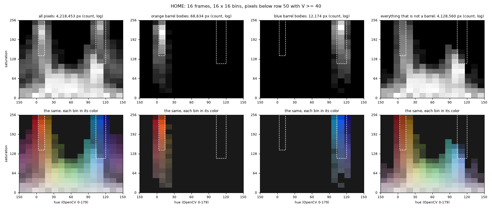
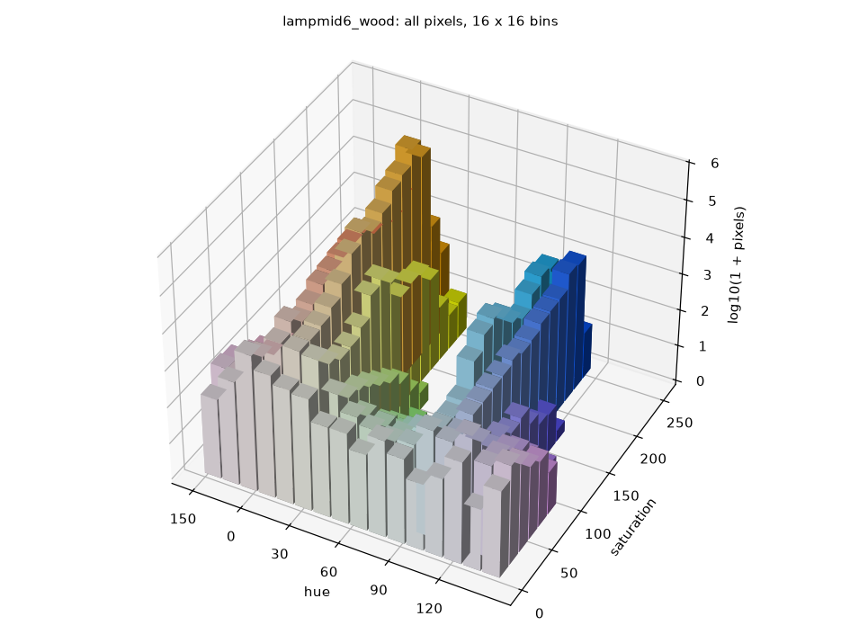
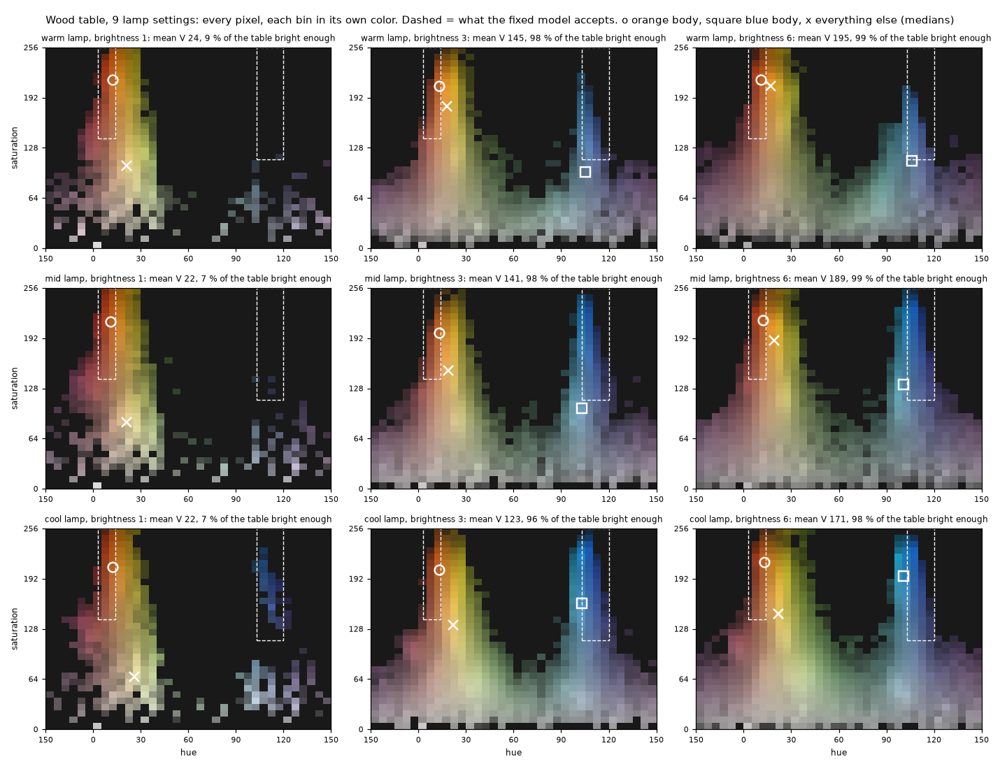
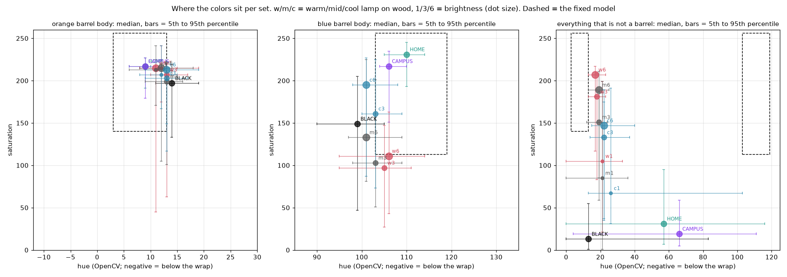
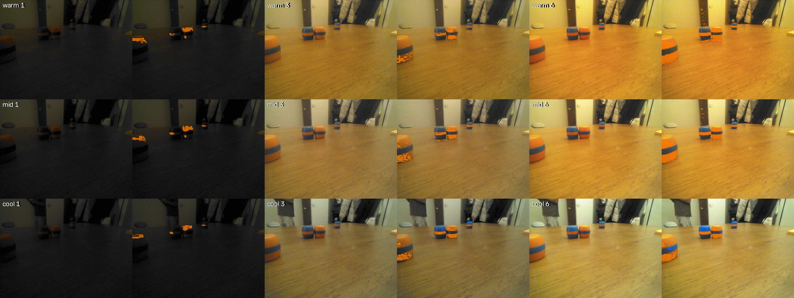
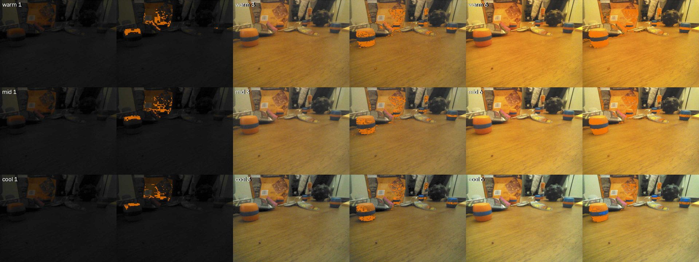

# Hue × saturation histograms: what moves between lights and tables (TODO 8)

Written by Claude for Tanush, 2026-11-16. Plain English. This is a look, not a method: nothing was tuned and nothing in the detector changed. Train frames only (HOME 16, CAMPUS 21, wood ladder 90, black 10). All numbers: `results/2026-11-16_hs_hist/summary.md`, script `experiments/2026-11-16_hs_hist/run.py`.

Make the pictures for any set yourself:

```zsh
python barrels/tools/hs_hist.py --filter lampwarm3_wood          # one lamp setting
python barrels/tools/hs_hist.py --filter campus_light --bins 32 32
```

## The short version

1. **The fixed color model misses the barrels on wood. It does not paint the table.** On the bright wood frames it labels about half of the orange body and a third of the blue body. It paints only 0.3 to 2.5 % of everything else.
2. **Hue moves by about half a sector.** Orange goes from 9 at home to 11 to 14 on wood and black. Blue goes from 110 at home to 99 to 106. The model's sectors (orange 3 to 13, blue 103 to 119) were fit at home, so half of each barrel falls outside.
3. **Blue loses its saturation under a warm lamp. Orange does not.** Blue S is 231 at home and about 100 under the warm lamp. Orange S stays near 210 everywhere.
4. **Blue is an easy fix. Orange on wood is a hard one.** A lookup placed in the right spot keeps 99 to 100 % of the blue body in every bright setting. For orange under the warm lamp no hue and saturation rule keeps more than about 70 %, because the wood table has the same color as the lit side of an orange barrel.
5. **Brightness 1 is too dark for the model's brightness gate.** Only 1 % of the blue pixels and a quarter of the orange ones are bright enough to be looked at.

## How to read the pictures

Every pixel below the horizon row goes into a grid: hue left to right, saturation bottom to top. Each cell is drawn in the color it stands for, brighter where more pixels fall. The dashed boxes are what the fixed model accepts as orange (left) and blue (right).

The barrel pixels come from your boxes. I take the inner part of each box that is not occluded, then keep the pixels at the main hue of that class. For HOME the masks give the same numbers a second way. The box shortcut sees barrel interiors only, so its percentages run a few points high: at home it says the model keeps 99 % of orange and 97 % of blue, the masks say 93 % and 80 %.

## Picture 1: home, where the model was fit



Top row is the pixel count in gray. Bottom row is each cell in its color. The orange and blue bodies sit inside their dashed boxes. Everything else sits low, in the gray band. This is why the model works at home and on campus.

The 3-D version you asked for, one bar per cell in its own color, here for the wood table at mid lamp, brightness 6:



## Picture 2: the wood table under the 9 lamp settings



Rows are warm, mid, cool. Columns are brightness 1, 3, 6. The circle is the orange body, the square the blue body, the cross everything else.

- The big orange and yellow column is the **table**. It stands right next to the orange box, at hue 17 to 22, and reaches saturation 200.
- The orange circle sits at the right edge of the dashed box or just outside it.
- The blue square sits below the blue box under warm and mid light and left of it under cool light.
- In the left column almost nothing is bright enough to count.

## Picture 3: where each color sits, set by set



One dot per set, with bars from the 5th to the 95th percentile. Left: orange body. Middle: blue body. Right: everything else.

| set | orange hue | orange S | model keeps | blue hue | blue S | model keeps | table hue | table S |
|---|---|---|---|---|---|---|---|---|
| HOME | 9 | 217 | 99 % | 110 | 231 | 97 % | 57 | 31 |
| CAMPUS | 9 | 217 | 98 % | 106 | 217 | 98 % | 66 | 19 |
| BLACK, window | 14 | 197 | 43 % | 99 | 149 | 16 % | 13 | 13 |
| wood, warm 3 | 13 | 207 | 46 % | 105 | 97 | 43 % | 18 | 181 |
| wood, warm 6 | 11 | 215 | 69 % | 106 | 111 | 46 % | 17 | 207 |
| wood, mid 3 | 13 | 199 | 48 % | 103 | 103 | 33 % | 19 | 151 |
| wood, mid 6 | 12 | 215 | 73 % | 101 | 133 | 30 % | 19 | 189 |
| wood, cool 3 | 13 | 203 | 46 % | 103 | 161 | 48 % | 22 | 133 |
| wood, cool 6 | 13 | 213 | 52 % | 101 | 195 | 31 % | 22 | 147 |

All values are medians. "Model keeps" is the share of the bright body pixels the fixed model labels.

Two things I did not expect:

- **The black table moves the colors as much as the lamp does**, under plain window light. Orange 14, blue 99. So this is not only the lamp's color. My guess is the camera's own exposure and white balance reacting to the scene. That is a guess; I have not tested it.
- **Both hues drift the same way**, toward yellow and green: orange up, blue down.

## Picture 4: what the model labels on one wood scene



Each pair is the raw frame and the model's labels, for the same scene under the 9 lights. The model catches the lower, shaded part of the orange barrels and the orange stripes in pieces. It catches the blue bodies only under the cool lamp. The table stays clean here.

With clutter the picture is different: a cardboard box and a wrapper are painted orange.



## Can any hue and saturation rule do the job?

For each set I built the best possible lookup: the cells with the most barrel and the least other stuff, taken until 1 % of the non-barrel pixels are painted. It is built on the frames it is scored on, so it is a ceiling. No real method will reach it.

| set | orange: fixed model | best H × S | best with brightness added | blue: fixed model | best H × S |
|---|---|---|---|---|---|
| HOME | 99 % | 100 % | 100 % | 97 % | 100 % |
| CAMPUS | 98 % | 100 % | 100 % | 98 % | 100 % |
| BLACK | 43 % | 99 % | 100 % | 16 % | 100 % |
| wood, warm 3 | 46 % | 66 % | 80 % | 43 % | 100 % |
| wood, warm 6 | 69 % | 72 % | 76 % | 46 % | 100 % |
| wood, mid 3 | 48 % | 82 % | 89 % | 33 % | 100 % |
| wood, mid 6 | 73 % | 80 % | 90 % | 30 % | 100 % |
| wood, cool 3 | 46 % | 89 % | 95 % | 48 % | 100 % |
| wood, cool 6 | 52 % | 91 % | 97 % | 31 % | 99 % |

What this says:

- **Blue: the thresholds are in the wrong place, nothing more.** Moved to the right place they keep everything. This is what an adaptive model can fix.
- **Black table: the same.** 43 % and 16 % today, 99 to 100 % possible.
- **Orange on wood: thresholds alone are not enough under warm and mid light.** About a quarter of the orange body has the same hue, saturation and brightness as the table. The detector has to carry that part with shape: the stripe, the size, the bottom edge.

Two more results from the same tables:

- **One fixed region for all settings does not exist for orange.** The best home lookup, used on the warm wood frames, keeps 82 to 87 % of the orange body but paints 29 to 48 % of the table. The best warm-wood lookup, used at home, keeps 46 %.
- **The model's own fitting recipe cannot be re-run on wood.** It takes percentiles of the barrel pixels and never looks at the table. Fit on the warm wood frames it would paint 47 to 87 % of the table. The thresholds have to be set with the table in view. Your slider labels in step 10 do exactly that.

## What I guessed before the run, and what happened

| guess | result |
|---|---|
| Hue moves little, saturation moves a lot | Half right. Hue moves 3 to 5 units for orange and 4 to 11 for blue, about the width of the body's own spread, and that is enough to leave the sector. Saturation falls hard for blue, not for orange. |
| The wood table overlaps orange in hue and saturation | Right. The ceiling is under 90 % in five of the six bright wood settings. |
| Brightness 1 fails on the brightness gate, not on color | Right. 1 % of blue and 18 to 30 % of orange pixels pass the gate. The orange ones that pass are labeled fine (87 to 93 %). |

## What the adaptation could key on (for us to decide together)

These are leads, not results. Each needs its own pre-registered test.

1. **Find the barrel peaks in the frame's own histogram.** Blue is alone in its part of the hue circle in every bright setting, so its peak is easy to find and gives the hue shift directly. Orange is next to the table peak, so its shift would have to be inferred from blue's, since both drift the same way.
2. **Use the table as the reference.** The table is the biggest peak in every frame. Where it sits (hue 13 to 22 and high saturation on wood, low saturation on white and black) tells which kind of scene this is.
3. **Lower the brightness gate in dark frames.** `v_min` is 40. At brightness 1 that throws away the frame. A gate that follows the frame's brightness is the simplest thing to try.
4. **Accept that orange on warm wood needs the detector.** Segmentation tops out near 70 to 80 % there. A broken orange body with a clean blue stripe may still be enough for the stripe detector; that is measurable now with `tools/report.py` on the wood train frames.

Not on the list: correcting the image. That stays ruled out.

## What I need from you

- Look at the four pictures. Tell me if anything does not match what you saw live.
- Pick which leads to test first, or tell me to pick. My order would be 4 (measure where the detector stands on wood today), then 1 and 3.
